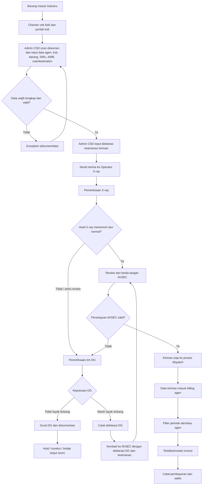
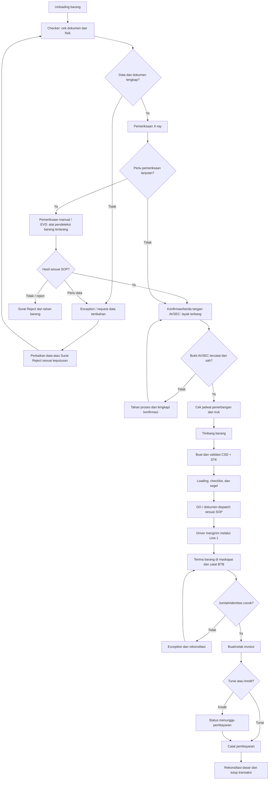
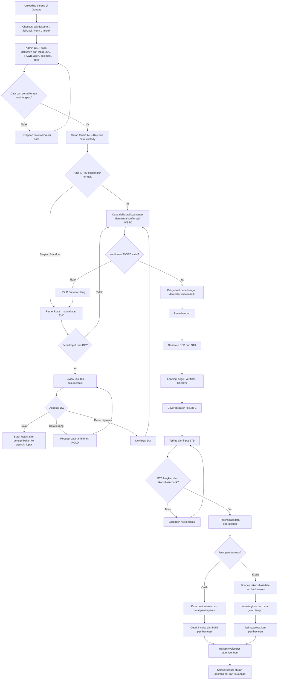

# PRODUCT REQUIREMENTS DOCUMENT (PRD)
## Airport Cargo Security & Dispatch Management System

- **Versi:** 1.7
- **Status:** Baseline untuk review, development, QA, dan UAT
- **Bahasa:** Indonesia
- **Dokumen:** PRD lengkap terintegrasi — alur Gatrans end-to-end, security clearance, dispatch, dokumen, cash/kredit, keuangan dasar, dan shift handover

---

## 1. Ringkasan Eksekutif

Airport Cargo Security & Dispatch Management System adalah aplikasi operasional untuk mengelola penerimaan dan pemeriksaan barang, validasi dokumen, X-ray dan pemeriksaan lanjutan menggunakan alat EVD (alat pendeteksi barang terlarang), pencatatan tanda tangan/konfirmasi AVSEC bahwa barang layak terbang, penimbangan, pembuatan CSD dan STK di dalam sistem, perencanaan jadwal penerbangan/truk, loading dan segel, dispatch oleh Driver melalui Line 1, penerimaan BTB, serta invoice dan pencatatan pembayaran dasar. Sistem juga menyediakan piece-level tracking, exception/insiden, bukti serah terima digital, pergantian shift, SLA, dashboard, dan audit trail.

Sistem harus menyediakan jejak audit dari awal hingga akhir. Sistem tidak boleh mengizinkan proses dispatch melewati kontrol keamanan atau mengubah status barang menjadi `DELIVERED` hanya karena DO telah diterbitkan.

### 1.1 Tujuan bisnis
- Menyatukan proses operasional kargo dalam alur yang dapat dipantau.
- Mengurangi input ulang melalui scan barcode/QR dan pengisian data dari sumber terverifikasi.
- Memastikan hasil X-ray dan bukti tanda tangan/konfirmasi AVSEC bahwa barang layak terbang tercatat dan terikat pada data yang tepat; AVSEC tidak menjadi role pengguna aplikasi.
- Mengendalikan penimbangan, pembuatan CSD/STK, jadwal pengiriman, loading/segel, pembuatan dan penerbitan DO, serta dispatch.
- Melacak setiap unit fisik, bukan hanya jumlah total konsinyasi.
- Mengelola hold, reject, ketidaksesuaian, dan insiden melalui exception case.
- Menyediakan bukti digital serah terima ke maskapai, BTB, invoice, dan pencatatan pembayaran dasar.
- Menjaga kontinuitas operasional saat pergantian shift atau gangguan sistem.
- Menyediakan dashboard, laporan, SLA, dan audit trail.

### 1.2 Prinsip desain
1. **Security first:** tidak ada bypass atas kontrol keamanan wajib.
2. **Traceability:** setiap status penting dapat ditelusuri ke aktor, waktu, data, dan bukti.
3. **Piece-level accountability:** identitas unit fisik dan kuantitas sama-sama direkonsiliasi.
4. **Separation of duties:** kewenangan dipisahkan sesuai SOP.
5. **Fail safe:** data/kontrol yang tidak dapat diverifikasi tidak dianggap lulus.
6. **Idempotency:** scan atau request berulang tidak membuat transaksi ganda.
7. **Configurable SOP:** SLA dan aturan operasional ditentukan pemilik proses.
8. **Evidence integrity:** bukti dilindungi melalui kontrol akses dan riwayat perubahan.

---

## Alur Bisnis Utama — Penerimaan, Security Clearance, DG, dan Billing Agen

### A. Penerimaan kargo dari Gatrans
1. Barang tiba di area Gatrans dan diserahkan untuk proses penerimaan.
2. Checker memeriksa kondisi fisik awal dan jumlah koli.
3. Admin CSD memindai dokumen pengiriman dan memasukkan/memverifikasi data:
   - Nama agen
   - Jumlah koli
   - Deskripsi/jenis barang
   - Nomor SMU
   - Nomor AWB
   - Rute dan destination
   - Referensi dokumen pendukung dan tanggal penerimaan
4. Sistem memvalidasi field wajib dan mencegah duplikasi SMU/AWB sesuai aturan bisnis. Jika dokumen atau data tidak lengkap, record ditahan dalam status exception dan tidak dianggap siap dikirim.
5. Admin CSD menyusun deklarasi keamanan kiriman berdasarkan dokumen dan data yang terverifikasi.

### B. Pemeriksaan X-ray dan keputusan keamanan
1. Checker menyerahkan barang kepada Operator X-ray; perpindahan tanggung jawab dicatat.
2. Operator X-ray memindai/memilih kiriman yang benar dan mencatat hasil sesuai pilihan status yang disahkan SOP.
3. Jika hasil memenuhi syarat, kiriman melanjutkan proses deklarasi keamanan dan peninjauan/tanda tangan AVSEC.
4. Jika kiriman tidak layak atau memerlukan pemeriksaan lebih lanjut, kiriman masuk antrean DG. Status tetap ditahan sampai keputusan dan dokumen yang diwajibkan lengkap.

### C. Jalur DG
1. Petugas DG memeriksa dokumen, deklarasi, dan barang sesuai SOP Dangerous Goods serta kewenangan yang berlaku.
2. Hasil pemeriksaan dicatat beserta petugas, waktu, alasan, checklist, dan bukti pendukung.
3. Jika barang/dokumen dinyatakan tidak layak terbang:
   - Status kiriman menjadi `DG_NOT_FIT_TO_FLY` atau status ekuivalen yang disahkan.
   - Petugas DG berwenang menerbitkan surat resmi sesuai template organisasi.
   - Surat dan dokumentasi pendukung dilampirkan pada kasus, termasuk alasan, dokumen kurang, foto bila diperlukan, dan kronologi.
   - Kiriman tidak dapat melanjutkan ke dispatch sampai ada proses koreksi/keputusan resmi yang memperbolehkan.
4. Jika DG menyatakan kiriman masih dapat diterbangkan:
   - DG mencatat deklarasi/hasil DG dan bukti pemeriksaan.
   - Kiriman dikembalikan ke proses AVSEC untuk peninjauan akhir.
   - Deklarasi DG dan deklarasi keamanan kiriman/AVSEC harus saling terhubung dengan kiriman yang sama.
   - AVSEC menandatangani/menyatakan layak kirim hanya setelah persyaratan dan deklarasi yang berlaku lengkap.
5. Sistem tidak membuat keputusan keselamatan otomatis. Aplikasi hanya menerapkan workflow, kelengkapan data, kewenangan, dan pencatatan keputusan petugas.

### D. Persetujuan AVSEC dan kesiapan kirim
1. AVSEC menandatangani atau mengonfirmasi status layak kirim sesuai prosedur resmi.
2. Sistem merekam identitas petugas, waktu, deklarasi yang disetujui, dan versi data/dokumen yang ditinjau.
3. Jika data kritis atau deklarasi berubah setelah persetujuan, approval ditandai perlu ditinjau ulang sesuai matriks perubahan.
4. Hanya kiriman dengan seluruh prasyarat keamanan valid yang dapat melanjutkan ke tahap operasional berikutnya.

### E. Billing dan invoice per agen/periode
1. Setiap kiriman ditautkan ke satu agen yang terdaftar.
2. Sistem mencatat komponen tagihan berdasarkan tarif dan aturan billing yang disetujui organisasi. Tarif tidak diasumsikan oleh aplikasi.
3. Admin/Finance yang diberi izin dapat membuat invoice berdasarkan:
   - Periode tanggal (tanggal mulai–akhir atau periode bulanan)
   - Agen
   - Status invoice (draft, terbit, sebagian dibayar, lunas, batal)
4. Sistem mendukung dua kebutuhan laporan:
   - **Rekap invoice per periode:** total seluruh agen untuk periode yang dipilih.
   - **Tagihan per agen per periode:** daftar kiriman, komponen biaya, total invoice, pembayaran, dan saldo per agen.
5. Sistem mencegah kiriman yang sama ditagihkan dua kali untuk komponen biaya yang sama, kecuali ada koreksi/penyesuaian resmi dengan audit trail.
6. Invoice dapat dicetak/diunduh sesuai template yang disetujui.
7. Pembayaran dicatat dengan tanggal, jumlah, metode/referensi pembayaran, penerima pencatatan, invoice yang dialokasikan, dan saldo tersisa. Cakupan ini adalah pencatatan pembayaran dasar, bukan general ledger/accounting penuh.
8. Pembatalan, koreksi, dan penerbitan ulang invoice harus mempertahankan histori dan alasan.

### Diagram flow ringkas

### Data tambahan yang diperlukan
- `agents`: master agen, kode agen, nama, kontak, status, dan data penagihan yang diperlukan.
- `consignments`: referensi agen, SMU, AWB, koli, deskripsi barang, rute/destination, tanggal, dan status proses.
- `security_declarations`: jenis deklarasi, versi, pengisi, waktu, status, dan referensi dokumen.
- `dg_reviews`: hasil review DG, keputusan, petugas, checklist, alasan, dan waktu.
- `dg_letters`: nomor surat, jenis surat, versi, penerbit, waktu, status, dan lampiran.
- `billing_items`: kiriman, agen, komponen tarif, kuantitas, harga yang disetujui, dan total.
- `invoices`: nomor invoice, agen, periode, tanggal terbit/jatuh tempo bila digunakan, subtotal, pajak bila berlaku, total, status, dan versi.
- `payments` serta `payment_allocations`: pencatatan pembayaran dan alokasi pembayaran ke invoice.
- Seluruh perubahan status, deklarasi, surat, invoice, dan pembayaran masuk audit trail.

### Acceptance criteria tambahan untuk flow bisnis
- **AC-095:** Data agen, koli, deskripsi barang, SMU, AWB, rute, dan destination dapat direkam dan divalidasi sesuai field wajib yang disepakati.
- **AC-096:** Kiriman dengan field wajib tidak lengkap tidak dapat ditandai siap untuk proses berikutnya.
- **AC-097:** Perpindahan tanggung jawab Checker ke Operator X-ray tercatat.
- **AC-098:** Hasil X-ray yang memerlukan pemeriksaan lanjutan mengarahkan kiriman ke antrean DG dan mempertahankan status hold.
- **AC-099:** Keputusan DG menyimpan petugas, waktu, alasan, dan bukti.
- **AC-100:** Jika DG menyatakan tidak layak terbang, petugas DG yang berwenang dapat menerbitkan surat resmi beserta dokumentasinya.
- **AC-101:** Jika DG menyatakan masih layak terbang, deklarasi DG terhubung ke kiriman dan diwajibkan tersedia sebelum review AVSEC akhir.
- **AC-102:** Status layak kirim memerlukan konfirmasi/tanda tangan AVSEC yang valid sesuai SOP.
- **AC-103:** Kiriman dan billing item terhubung ke master agen yang benar.
- **AC-104:** Pengguna berwenang dapat memfilter invoice berdasarkan rentang tanggal/periode dan agen.
- **AC-105:** Laporan per agen/periode menampilkan daftar kiriman, item tagihan, total invoice, pembayaran, dan saldo.
- **AC-106:** Sistem mencegah penagihan ganda atas kiriman dan komponen tarif yang sama kecuali penyesuaian resmi tercatat.
- **AC-107:** Pembayaran dapat dicatat dan dialokasikan ke invoice; saldo dihitung konsisten.
- **AC-108:** Koreksi invoice, surat DG, atau deklarasi mempertahankan versi sebelumnya dan alasan perubahan.

## 2. Ruang Lingkup

### 2.1 Termasuk dalam ruang lingkup
- Autentikasi, RBAC, dan manajemen pengguna.
- Penerimaan kargo dan scan barcode/QR.
- Lookup dan pengelolaan data konsinyasi/AWB serta pembuatan dan pengelolaan CSD dan STK di sistem.
- Registrasi dan pelacakan piece/unit fisik.
- Antrean dan hasil pemeriksaan X-ray.
- Hold, reject, pemeriksaan ulang, exception, dan insiden.
- Pencatatan tanda tangan/konfirmasi AVSEC bahwa barang layak terbang setelah X-ray dan pemeriksaan yang diwajibkan.
- Pembuatan otomatis draft DO setelah prasyarat terpenuhi.
- Penjadwalan penerbangan/truk, penimbangan, CSD/STK, loading/segel, DO, dan dispatch oleh Driver.
- Rekonsiliasi sebelum serah terima.
- Digital Proof of Handover ke gudang maskapai.
- Shift handover dan logbook.
- Checklist dokumen/fisik, pemeriksaan lanjutan manual/EVD, surat reject, dan permintaan data tambahan.
- Penimbangan, pembuatan/penyimpanan CSD dan STK, rencana transportasi, loading/segel, dispatch Line 1, dan penerimaan BTB.
- Invoice dasar: pembuatan/cetak invoice dan pencatatan pembayaran, tanpa modul piutang/akuntansi penuh.
- SLA monitoring, peringatan, dan eskalasi.
- Dashboard, laporan, pencarian, dan ekspor sesuai izin.
- Audit trail, histori status, backup, pemulihan, dan monitoring teknis.

### 2.2 Di luar ruang lingkup baseline
- Mengendalikan perangkat X-ray atau membuat keputusan keamanan otomatis.
- Menggantikan SOP dan penilaian profesional AVSEC.
- Integrasi sistem maskapai, CSD, atau bandara sebelum spesifikasi dan akses tersedia.
- Akuntansi penuh, general ledger, pajak kompleks, tarif/revenue management, aging piutang, dan integrasi payment gateway. Cakupan hanya pembuatan/cetak invoice dan pencatatan pembayaran dasar.
- GPS/IoT real-time kecuali disetujui sebagai fase lanjutan.
- AI untuk menentukan hasil X-ray.
- Menetapkan SLA, retensi data, atau aturan pemeriksaan yang belum disahkan pemilik proses.

---

## 3. Pengguna, Peran, dan Hak Akses

Aplikasi memiliki **empat role utama** (Admin, Checker, Handler, Driver). Untuk penanganan barang berbahaya/terlarang dan barang reject/tidak berangkat, sistem juga mendukung **otorisasi fungsi DG (Dangerous Goods)** sebagai hak akses khusus yang dapat diberikan kepada petugas yang ditunjuk dari role yang disepakati organisasi. Fungsi DG tidak otomatis menjadi role/login kelima; bila organisasi memutuskan tim DG harus memiliki akun/role tersendiri, keputusan itu harus disahkan sebelum implementasi. Setiap penerbitan surat oleh fungsi DG wajib tercatat atas identitas pengguna aktual. AVSEC bukan role/login aplikasi. AVSEC bukan role/login aplikasi; petugas AVSEC menandatangani atau mengonfirmasi kelayakan terbang setelah pemeriksaan X-ray sesuai SOP. Pengguna berwenang (Admin atau Checker sesuai SOP) mencatat referensi tanda tangan/konfirmasi tersebut ke sistem. Pencatatan digital tidak menggantikan tanda tangan resmi yang diwajibkan.

| Role aplikasi | Tanggung jawab utama |
|---|---|
| **Admin** | Mengelola akun/konfigurasi yang diizinkan, menerima dan mencari data barang, membuat/mengelola konsinyasi, CSD/STK, penimbangan dan jadwal sesuai penugasan, mengelola DO/invoice dasar, mencatat pembayaran, dashboard dan laporan. Admin tidak dapat mengubah hasil keamanan atau memalsukan tanda tangan AVSEC. |
| **Checker** | Memeriksa kelengkapan dokumen dan fisik, memverifikasi barang/piece, mencatat hasil X-ray berdasarkan hasil resmi operator/perangkat sesuai SOP, mencatat pemeriksaan lanjutan/EVD, mengajukan kasus reject/tidak berangkat kepada fungsi DG atau petugas berwenang, serta mencatat bukti tanda tangan/konfirmasi AVSEC setelah barang dinyatakan layak terbang. |
| **Handler** | Menangani barang secara fisik, menimbang atau mencatat hasil timbang sesuai penugasan, menyiapkan CSD/STK bila diotorisasi, melakukan loading, pemasangan/pemeriksaan segel, serta menyiapkan dan mencatat serah terima barang kepada Driver. |
| **Driver** | Memeriksa penugasan/rute Line 1, mengonfirmasi barang dan segel sebelum berangkat, mengirim barang ke maskapai, serta mencatat penerimaan/BTB dan bukti serah terima yang menjadi tanggung jawabnya. |

### 3.1 Prinsip otorisasi
- Terapkan *least privilege* pada empat role utama serta izin fungsi DG yang diberikan secara eksplisit; izin dibatasi berdasarkan lokasi, shift, status transaksi, dan tindakan.
- Tidak ada role AVSEC di aplikasi. Tanda tangan/konfirmasi AVSEC harus memiliki nama/identitas petugas sesuai kebijakan, waktu, referensi dokumen/bukti, dan konsinyasi yang tepat.
- Admin tidak boleh mengubah hasil X-ray, membuat barang berstatus layak terbang tanpa bukti AVSEC yang sah, atau menghapus histori.
- Penerbitan DO, pencatatan invoice/pembayaran, dan perubahan data kritis hanya dapat dilakukan role yang diizinkan matriks akses.
- Pengguna tidak dapat memberikan persetujuan atas nama role/aktor lain. Akun bersama dilarang untuk tindakan kritis.
- Jika SOP mengharuskan pemisahan tugas, backend harus mencegah pengguna yang sama menyelesaikan tahapan yang dilarang untuk digabung.
- Hak fungsi DG bukan hak otomatis bagi seluruh pengguna. Pemberian, pencabutan, dan penggunaan hak tersebut dicatat dalam audit trail.
- Hanya pengguna yang diberi otorisasi DG boleh menetapkan keputusan DG dan menerbitkan Surat Reject DG. Admin sistem tidak boleh menggantikan keputusan DG hanya karena memiliki akses konfigurasi.

---

## 4. Alur Operasional End-to-End

### 4.1 Penerimaan dan lookup data
1. Receiving Admin memindai barcode/QR.
2. Sistem memvalidasi format dan mencari data pada sumber terintegrasi/registri yang disetujui.
3. Sistem hanya mengisi field yang benar-benar tersedia dan terverifikasi. Jika barcode hanya berisi ID, ID digunakan untuk lookup; field lain tidak boleh ditebak.
4. Data tidak ditemukan, konflik, atau tidak lengkap diarahkan ke exception.
5. Sistem mencatat aktor, waktu, stasiun/lokasi jika dikonfigurasi, dan hasil lookup.

### 4.2 Registrasi piece
1. Sistem mencatat jumlah piece yang direncanakan dan diterima.
2. Setiap unit fisik mendapatkan ID internal unik; barcode piece dapat dicetak bila perangkat dan SOP mendukung.
3. Piece tanpa identitas yang dapat diverifikasi tidak dianggap cocok hanya berdasarkan jumlah.

### 4.3 Pemeriksaan X-ray
1. Piece/konsinyasi masuk antrean sesuai SOP.
2. Operator memindai atau memilih unit yang tepat sebelum memasukkan hasil.
3. Hasil memakai daftar status terkontrol, misalnya `PASS`, `HOLD`, `REJECT`, atau `REVIEW_REQUIRED`; nilai final ditentukan SOP.
4. Hasil mencatat operator, waktu, catatan, stasiun/perangkat bila tersedia, versi data, dan referensi bukti.
5. Hasil non-pass tidak boleh dianggap lulus.
6. Pemeriksaan ulang menjadi catatan baru; hasil sebelumnya tetap tersimpan.

### 4.4 Penanganan hold/reject/insiden dan review DG
1. Setiap barang yang berstatus reject, tidak berangkat, tidak memenuhi kelengkapan dokumen, atau dinilai tidak layak terbang harus masuk ke exception/case dan ditahan dari alur dispatch normal.
2. Case diarahkan ke tim DG atau petugas yang diberi otorisasi fungsi DG untuk memeriksa alasan, dokumen, hasil X-ray/EVD/manual, identitas barang/piece, dan bukti pendukung.
3. Fungsi DG menentukan tindak lanjut sesuai SOP: meminta dokumen/data tambahan, meminta koreksi, menahan barang, menolak barang, atau mengembalikan ke proses pemeriksaan ulang bila memang diizinkan. Sistem tidak menetapkan kelayakan terbang secara otomatis.
4. Jika dokumen wajib tidak lengkap dan/atau barang dinyatakan tidak layak terbang, pengguna DG yang berwenang menerbitkan **Surat Reject DG** menggunakan template resmi. Surat wajib mencantumkan nomor unik, tanggal/waktu, identitas konsinyasi/AWB dan piece terkait, alasan/kode alasan, status barang, referensi pemeriksaan, penerbit, versi dokumen, serta lampiran/bukti yang diperlukan.
5. Dokumentasi case wajib menyimpan bukti yang relevan, seperti foto barang/label/kemasan, dokumen yang diterima atau kurang, hasil X-ray/EVD/manual yang diizinkan untuk dicatat, catatan pemeriksaan, kronologi, korespondensi/request data tambahan, serta salinan Surat Reject DG. Jenis bukti wajib ditetapkan melalui SOP dan dapat dikonfigurasi.
6. Surat yang telah diterbitkan tidak boleh dihapus atau ditimpa. Koreksi dilakukan melalui revisi/ pembatalan terotorisasi dengan alasan, versi baru, hubungan ke versi sebelumnya, dan audit trail.
7. Barang reject/tidak berangkat tidak dapat diubah menjadi layak terbang hanya dengan menutup exception. Untuk kembali ke proses pengiriman, dokumen harus dilengkapi, pemeriksaan yang diwajibkan diulang, dan bukti konfirmasi AVSEC yang sah diperoleh sesuai SOP.
8. Resolusi dan penutupan case harus memiliki bukti/catatan yang sesuai serta pengguna penanggung jawab yang jelas.

### 4.5 Tanda tangan/konfirmasi AVSEC — bukan role aplikasi
1. Setelah X-ray dan pemeriksaan lanjutan yang diwajibkan selesai, Checker memastikan hasil pemeriksaan dan dokumen terkait lengkap.
2. Petugas AVSEC melakukan pemeriksaan/penilaian sesuai SOP di luar role aplikasi dan menandatangani atau memberikan konfirmasi resmi bahwa barang layak terbang.
3. Admin atau Checker yang ditunjuk mencatat referensi tanda tangan/konfirmasi ke sistem. Bukti dapat berupa nomor dokumen, identitas petugas, waktu, scan/foto dokumen bertanda tangan, atau mekanisme digital resmi yang disetujui.
4. Sistem tidak menyediakan akun AVSEC, tidak membuat tanda tangan atas nama AVSEC, dan tidak menyimpulkan kelayakan terbang secara otomatis.
5. Catatan konfirmasi terikat pada konsinyasi/piece dan versi data yang diperiksa. Jika data kritis berubah sesudah tanda tangan, status ditahan dan tanda tangan/konfirmasi baru diperlukan sesuai SOP.
6. Tanpa bukti konfirmasi AVSEC yang diwajibkan, barang tidak boleh diteruskan ke DO final/dispatch.

### 4.6 Pembuatan dan penerbitan DO
1. Setelah persetujuan AVSEC valid dan prasyarat lain terpenuhi, sistem membuat draft DO otomatis.
2. Draft mempunyai nomor referensi unik sesuai konfigurasi.
3. Dispatch Officer memverifikasi data DO, status keamanan, exception pemblokir, dan rekonsiliasi piece.
4. Jika semua valid, Dispatch Officer menerbitkan DO.
5. Draft tidak boleh dianggap dokumen final atau izin dispatch.
6. Amend/cancel DO yang sudah terbit mengikuti proses berwenang dan mempertahankan histori versi sebelumnya.

### 4.7 Serah terima ke gudang maskapai
1. Handover harus terkait DO yang telah terbit.
2. Petugas memindai piece terhadap daftar DO.
3. Sistem memeriksa identitas dan jumlah aktual.
4. Catat pihak penyerah/penerima, waktu, lokasi jika tersedia, kondisi barang, konfirmasi/tanda tangan digital sesuai kebijakan, dan lampiran.
5. Selisih, kerusakan, piece hilang, atau identitas tidak cocok membuat exception dan mencegah penutupan otomatis.
6. `DELIVERED` hanya diberikan setelah seluruh syarat serah terima yang disahkan terpenuhi.

### 4.8 Penutupan dan pelaporan
- Sistem menyimpan Digital Proof of Handover (PoH).
- Konsinyasi dan exception ditutup berdasarkan aturan, bukan hanya karena proses berikutnya dimulai.
- Dashboard dan laporan menggunakan catatan transaksi sumber.

### 4.9 Checklist dokumen dan fisik oleh Checker
- Checker membandingkan identitas barang dengan dokumen sumber, nomor AWB/referensi, jumlah piece, label, kondisi kemasan, serta dokumen wajib sesuai checklist yang disahkan.
- Field wajib checklist harus dapat dikonfigurasi oleh Admin yang berwenang. Checklist yang belum lengkap menahan proses dan membuat exception bila diperlukan.
- Perbedaan data, kerusakan, barang ekstra/kurang, atau label tidak terbaca harus dicatat dengan alasan dan bukti.

### 4.10 Pemeriksaan lanjutan, EVD, surat reject, dan data tambahan
- EVD didefinisikan dalam PRD ini sebagai **alat pendeteksi barang terlarang**. Jenis alat, cara pengoperasian, arti hasil, batas penggunaan, dan kriteria keputusan wajib dikonfirmasi dengan tim operasional serta SOP; sistem tidak mengarang aturan deteksi.
- Hasil pemeriksaan manual/EVD dicatat sebagai peristiwa pemeriksaan tersendiri, termasuk petugas pencatat, waktu, referensi alat jika tersedia, hasil sesuai daftar resmi, catatan, dan bukti.
- Jika barang reject/tidak berangkat atau dokumen tidak lengkap/tidak layak terbang, sistem mengarahkan case ke fungsi DG. Pengguna DG yang berwenang memeriksa kasus, melampirkan dokumentasi, dan menerbitkan Surat Reject DG dari template resmi. Barang ditahan/dikeluarkan dari alur normal sesuai SOP.
- Jika diperlukan data tambahan, sistem mencatat permintaan, field/dokumen yang kurang, pihak yang diminta, tenggat bila ditetapkan, respons, bukti, dan keputusan setelah data diterima. Data baru tidak otomatis berarti barang lolos.

### 4.11 Jadwal penerbangan, ketersediaan truk, dan penimbangan
- Admin/Handler yang ditugaskan mencatat atau memilih jadwal penerbangan, batas waktu cut-off jika diketahui, rencana truk/driver, kapasitas, dan status kesiapan pengiriman.
- Sistem menampilkan konflik jadwal, truk tidak tersedia, atau kapasitas yang tidak memadai sebagai blocker/exception. Sistem tidak mengarang data jadwal dari sumber yang belum terintegrasi.
- Hasil timbang mencakup berat aktual, satuan, tanggal/waktu, petugas, referensi alat/tiket timbang jika tersedia, dan koreksi dengan alasan. Berat bruto/neto/dimensi hanya dicatat sesuai field dan proses yang benar-benar digunakan.
- CSD/STK tidak boleh difinalisasi jika field wajib sesuai template dan SOP belum lengkap.

### 4.12 Pembuatan dan pengelolaan CSD/STK
- Sistem membuat, menyimpan, mencari, mencetak, dan mengelola versi CSD serta STK; keduanya merupakan dokumen yang dikelola di dalam aplikasi.
- Nomor dokumen unik mengikuti pola yang disetujui. Isi dokumen ditarik dari data konsinyasi, hasil timbang, piece, jadwal, dan field resmi yang relevan.
- Sistem memvalidasi field wajib, mencegah nomor ganda, menyimpan pembuat/waktu/revisi, serta menghubungkan dokumen ke konsinyasi dan pengiriman.
- Perubahan setelah dokumen diterbitkan harus menghasilkan revisi atau pembatalan yang terotorisasi; dokumen lama dan jejak perubahan tetap tersedia. Format dan kepanjangan resmi CSD/STK harus dikonfirmasi oleh pemilik proses.

### 4.13 Loading, segel, dispatch Line 1, dan BTB
- Sebelum loading, Handler memverifikasi daftar piece, status keamanan/kelayakan terbang, CSD/STK, jadwal, dan penugasan.
- Sistem mencatat waktu loading, piece yang dimuat, kondisi barang, identitas Handler, nomor segel, kondisi segel, kendaraan/Driver, dan bukti foto bila diwajibkan.
- Driver hanya dapat mengonfirmasi dispatch bila seluruh prasyarat yang diwajibkan terpenuhi. Catat waktu berangkat, rute/Line 1, tujuan maskapai, kendaraan, Driver, dan referensi dokumen.
- Saat barang diterima maskapai, catat jumlah dan identitas aktual, waktu, pihak penerima bila tersedia, kondisi, BTB (Bukti/Tanda Terima Barang sesuai definisi lokal), nomor dokumen, dan lampiran. Selisih memicu exception dan menahan penutupan pengiriman sesuai kebijakan.

### 4.14 Invoice dan pencatatan pembayaran dasar
- Sistem mendukung pembuatan dan cetak invoice dari data operasional yang disetujui, serta pencatatan pembayaran. Ini bukan modul akuntansi penuh.
- Mendukung metode tunai dan kredit sebagai penanda alur: tunai dapat dicatat lunas setelah pembayaran diterima; kredit dapat dicatat sebagai invoice belum dibayar/menunggu pembayaran.
- Field minimum invoice: nomor unik, tanggal, referensi konsinyasi/pengiriman, pihak yang ditagih sesuai data tersedia, rincian layanan/biaya yang diinput atau dikonfigurasi, total, status pembayaran, dan versi dokumen. Aturan pajak/biaya harus ditentukan pemilik proses.
- Catatan pembayaran meliputi invoice, jumlah diterima, tanggal/waktu, metode, referensi bukti/kwitansi, pencatat, dan catatan. Sistem tidak memproses transfer uang dan tidak terintegrasi payment gateway dalam cakupan ini.
- Jika pembayaran parsial diizinkan, sisa tagihan dihitung sebagai nilai invoice dikurangi total pembayaran yang valid. Koreksi pembayaran harus menjadi transaksi pembalik/koreksi dengan audit, bukan menghapus catatan lama.
- Finance/accounting eksternal, general ledger, rekonsiliasi bank otomatis, aging piutang lanjutan, dan pajak kompleks berada di luar cakupan.

### 4.15 Diagram alur

SLA, audit trail, dan shift handover berjalan lintas tahapan; ketiganya tidak boleh mengesampingkan kontrol keamanan.

---

## 5. Status dan State Machine

### 5.1 Status konsinyasi
- `RECEIVED`
- `DATA_EXCEPTION`
- `PIECE_RECONCILIATION`
- `AWAITING_XRAY`
- `XRAY_HOLD`
- `XRAY_REVIEW_REQUIRED`
- `XRAY_REJECTED`
- `AWAITING_AVSEC_CONFIRMATION`
- `AVSEC_CONFIRMATION_HELD`
- `FIT_TO_FLY_CONFIRMED`
- `DO_DRAFT`
- `DO_ISSUED`
- `AWAITING_WAREHOUSE_HANDOVER`
- `HANDOVER_DISCREPANCY`
- `DELIVERED`
- `CANCELLED` (hanya jika kebijakan dan kewenangan mengizinkan)

Status final dan transisi harus disesuaikan dengan SOP resmi. Status tidak boleh diubah bebas melalui form administrasi.

### 5.2 Status piece
- `REGISTERED`
- `RECEIVED`
- `AWAITING_XRAY`
- `XRAY_PASS`
- `XRAY_HOLD`
- `XRAY_REVIEW_REQUIRED`
- `XRAY_REJECTED`
- `AVSEC_PENDING`
- `FIT_TO_FLY_CONFIRMED`
- `DO_ASSIGNED`
- `HANDED_OVER`
- `DISCREPANCY`
- `CANCELLED` (dengan otorisasi dan alasan)

Setiap perubahan status menghasilkan event histori. Piece tidak boleh melewati kontrol wajib.

### 5.3 Status exception
- `OPEN`
- `ASSIGNED`
- `IN_PROGRESS`
- `PENDING_REVIEW`
- `RESOLVED`
- `CLOSED`

`RESOLVED` berarti penyelesaian diajukan/dilakukan. `CLOSED` hanya dapat dilakukan pihak berwenang setelah kriteria penutupan terpenuhi.

### 5.4 Status DO
- `DRAFT`
- `PENDING_VERIFICATION`
- `ISSUED`
- `AMENDED` atau versi revisi yang terkait
- `CANCELLED` jika dibatalkan secara sah

Draft bukan DO terbit. Semua versi harus dapat ditelusuri.

---

## 6. Kebutuhan Fungsional

### FR-01 — Autentikasi dan sesi
- Pengguna masuk menggunakan akun individual.
- Sistem menerapkan kebijakan password dan sesi organisasi.
- Sesi tidak valid ditolak; akun dinonaktifkan tidak dapat membuat transaksi baru.
- Autentikasi ulang dapat diwajibkan untuk tindakan berisiko tinggi.

### FR-02 — Pengguna dan role
- Pengguna berwenang dapat membuat, mengubah, atau menonaktifkan akun serta menetapkan role.
- Izin diperiksa di backend pada setiap tindakan kritis.
- Perubahan role tercatat.
- Role tidak memberi izin lintas fungsi secara implisit.

### FR-03 — Penerimaan dan scan barcode/QR
- Mendukung scanner USB/Bluetooth mode keyboard wedge bila kompatibel.
- Input manual dapat menjadi fallback terbatas; alasan dicatat jika disyaratkan SOP.
- Memvalidasi format, duplikasi, dan keberadaan ID.
- Lookup hanya dari sumber yang disetujui.
- Menampilkan status validasi dan sumber data bila tersedia.
- Tidak menebak field yang tidak tersedia.
- Menyediakan exception untuk label rusak/tidak terbaca atau data tidak ditemukan.

### FR-04 — Konsinyasi dan CSD
- Menampilkan data konsinyasi/CSD yang relevan dari sumber terverifikasi.
- Menyimpan referensi sumber dan waktu lookup/sinkronisasi.
- Menandai field wajib kosong atau konflik.
- Perubahan field kritis menyimpan nilai sebelum/sesudah dan alasan.
- Sistem sumber resmi, pemetaan field, dan metode integrasi ditetapkan dalam desain integrasi.

### FR-05 — Piece-level tracking
- Satu konsinyasi dapat memiliki banyak piece.
- Setiap piece memiliki ID internal unik dan dapat memiliki barcode sendiri.
- Mencatat jumlah direncanakan, diterima, diperiksa, disetujui, tercantum di DO, dan diserahkan.
- Memeriksa identitas piece, bukan hanya jumlah.
- Mencegah piece dihitung dua kali pada tahap yang sama.
- Mendeteksi piece hilang, ekstra, tertukar, duplikat, atau belum melewati pemeriksaan wajib.
- Partial handover hanya jika kebijakan mengizinkan dan kontrolnya dikonfigurasi.

### FR-06 — Antrean dan hasil X-ray
- Antrean dapat diurutkan menurut prioritas, status, dan waktu tunggu.
- Operator memilih/memindai unit sebelum mencatat hasil.
- Hasil memakai nilai terkontrol yang disetujui pemilik SOP.
- Catatan mencakup operator, timestamp, catatan, stasiun/perangkat bila tersedia, versi data, dan bukti.
- Hasil non-pass memicu status terkendali dan/atau exception.
- Pemeriksaan ulang mempertahankan hasil terdahulu.
- Perubahan hasil dibatasi pada peran berwenang dengan alasan dan audit.

### FR-07 — Exception & Incident Management
Kategori awal:
- Barcode tidak dikenal/tidak terbaca.
- Data CSD tidak cocok/tidak lengkap.
- X-ray hold, review, atau reject.
- Label atau identitas piece bermasalah.
- Piece hilang, ekstra, atau duplikat.
- AVSEC pending/ditolak.
- Kesalahan DO.
- Selisih/kerusakan saat handover.
- Kegagalan perangkat, jaringan, atau integrasi.
- Insiden operasional lain yang disetujui.

Setiap case memuat nomor unik, kategori, alasan, prioritas, status, referensi konsinyasi/piece/DO, PIC, waktu dibuat, tenggat, bukti, kronologi tindakan, resolusi, pihak penyelesai, dan persetujuan penutupan bila diperlukan.

### FR-08 — Pencatatan tanda tangan/konfirmasi AVSEC
- Tidak ada akun atau role AVSEC di aplikasi.
- Admin/Checker yang ditunjuk mencatat bukti tanda tangan/konfirmasi resmi AVSEC bahwa barang layak terbang setelah X-ray dan pemeriksaan lanjutan yang diwajibkan.
- Sistem menyimpan identitas petugas AVSEC sesuai kebijakan, waktu, referensi tanda tangan/dokumen, lampiran bila ada, konsinyasi/piece, dan versi data yang dikonfirmasi.
- Sistem tidak boleh membuat, meniru, atau mengatribusikan tanda tangan kepada AVSEC secara otomatis.
- Data kritis yang berubah setelah konfirmasi menahan alur dan mewajibkan konfirmasi ulang sesuai SOP.
- SLA overdue hanya menghasilkan peringatan/eskalasi, bukan konfirmasi otomatis.

### FR-09 — Draft, verifikasi, dan penerbitan DO
- Sistem membuat draft setelah prasyarat terpenuhi.
- Nomor DO unik dan aman terhadap retry.
- Dispatch Officer memverifikasi sebelum penerbitan.
- Penerbitan memeriksa AVSEC, exception pemblokir, rekonsiliasi piece, dan field wajib.
- Menyimpan versi, aktor, waktu, dan alasan perubahan.
- Amend/cancel setelah terbit mengikuti prosedur resmi.
- Mendukung PDF sesuai template yang disetujui.

### FR-10 — Warehouse handover dan Digital Proof of Handover
- Handover terkait DO berstatus `ISSUED`.
- Piece dipindai terhadap daftar DO.
- Identitas dan jumlah aktual direkonsiliasi.
- Mencatat pihak, waktu, lokasi bila tersedia, kondisi, catatan, konfirmasi/tanda tangan digital sesuai kebijakan, dan lampiran.
- Expected count dan actual count dicatat.
- Selisih membuat exception dan mencegah auto-close.
- PoH memiliki nomor unik, referensi DO, piece, pihak, waktu, dan versi.
- PDF PoH dapat dihasilkan.
- Koreksi PoH menjadi revisi/event baru; bukti lama tidak dihapus diam-diam.

### FR-11 — Shift handover, logbook, dan laporan antar-manager
- Setiap shift memiliki susunan personel operasional yang dicatat dalam roster: **1 Manager Shift, 2 Supervisor Shift, 1–2 petugas DG, dan Senior AVSEC**. Jumlah DG dapat dikonfigurasi menjadi satu atau dua orang sesuai penugasan. Jika personel berubah, roster mencatat perubahan dan masa berlakunya.
- Setiap personel memiliki nama lengkap, jabatan, nomor WhatsApp, shift, status aktif, dan tanggal berlaku penugasan. Nomor WhatsApp merupakan data kontak operasional terbatas, hanya dapat dilihat oleh pengguna berwenang dan tidak ditampilkan pada laporan publik.
- **Manager Shift yang akan selesai bertugas bertanggung jawab menyerahkan shift kepada Manager Shift berikutnya.** Manager outgoing menyiapkan logbook/laporan; Manager incoming meninjau dan memberikan acknowledgment. Supervisor, petugas DG, dan Senior AVSEC memberikan update sesuai tanggung jawab masing-masing. Aplikasi mencatat mereka sebagai personel roster tanpa otomatis memberikan login aplikasi atau mengubah ketentuan bahwa AVSEC bukan role aplikasi.
- Handover tidak dianggap selesai sebelum manager incoming mengonfirmasi penerimaan laporan. Jika manager incoming belum tersedia, manager outgoing mencatat eskalasi/pengganti yang disahkan SOP; sistem tidak boleh mengarang acknowledgment.
- Logbook wajib memuat waktu mulai/akhir shift, lokasi, manager outgoing/incoming, daftar personel dan kontak, ringkasan aktivitas, barang dalam proses, barang layak terbang yang menunggu dispatch, barang reject/hold/tidak berangkat, case DG dan Surat Reject, dokumen yang kurang, hasil X-ray/EVD yang memerlukan tindak lanjut, status CSD/STK, penimbangan, jadwal/truk, loading/segel, DO/BTB, invoice/pembayaran yang masih terbuka, SLA overdue, gangguan sistem/perangkat, insiden, tindakan yang sudah dilakukan, PIC berikutnya, tenggat, serta lampiran/foto yang relevan.
- Sistem membuat daftar pekerjaan terbuka otomatis dari transaksi sumber; manager dapat menambahkan catatan manual dengan identitas pembuat. Catatan manual tidak boleh mengganti atau menghapus data transaksi sumber.
- Manager incoming dapat menerima, meminta klarifikasi, atau menolak handover dengan alasan. Jika ditolak, status tetap `PENDING_HANDOVER` sampai diperbaiki dan diterima atau dieskalasikan sesuai SOP.
- Semua case terbuka, reject, hold, discrepancy, tugas DG, dan SLA overdue tetap aktif dan wajib terbawa ke laporan shift berikutnya sampai selesai secara sah.
- Laporan handover memiliki nomor unik, versi, waktu dibuat/diserahkan/diterima, status, daftar lampiran, serta histori revisi. Setelah acknowledgment, koreksi dilakukan sebagai addendum/event baru; laporan asli tidak ditimpa atau dihapus.
- Sistem menyediakan tampilan cetak/PDF dan ekspor terbatas untuk laporan pergantian shift. Pengiriman WhatsApp dapat dilakukan melalui integrasi resmi jika disetujui; jika belum terintegrasi, aplikasi tetap menampilkan nomor kontak dan menyediakan laporan yang dapat dibagikan secara manual.
- Pergantian shift tidak mengubah status keamanan, tidak mengesahkan barang, tidak menerbitkan Surat Reject secara otomatis, dan tidak menutup case.

### FR-12 — SLA monitoring dan eskalasi
- SLA dapat dikonfigurasi per tahap/kategori.
- Policy menentukan event mulai/selesai, target, warning, escalation, kalender/shift, penerima, dan aturan pause.
- Memisahkan waktu tunggu, pengerjaan aktif, exception, dan pause yang diizinkan jika data tersedia.
- Mengirim warning sebelum jatuh tempo dan eskalasi setelah overdue.
- Mencatat hasil pengiriman notifikasi.
- SLA tidak melewati kontrol keamanan atau menutup case otomatis.
- Target numerik harus disahkan pemilik proses; PRD ini tidak mengarang nilainya.

### FR-19 — Checklist dokumen dan pemeriksaan fisik
- Menyediakan checklist configurable untuk dokumen dan pemeriksaan fisik barang.
- Menyimpan hasil per item checklist, Checker, waktu, alasan ketidaksesuaian, dan bukti.
- Checklist wajib yang belum selesai memblokir transisi sesuai SOP.

### FR-20 — Pemeriksaan manual/EVD, reject, dan permintaan data tambahan
- Mencatat pemeriksaan manual/EVD dengan hasil terkontrol yang disahkan SOP; EVD adalah alat pendeteksi barang terlarang.
- Membuat case DG untuk barang reject/tidak berangkat, dokumen tidak lengkap, atau barang tidak layak terbang.
- Hanya pengguna dengan otorisasi fungsi DG dapat memutuskan tindak lanjut DG dan menerbitkan Surat Reject DG.
- Surat Reject DG harus memiliki nomor unik, alasan, identitas barang/AWB/piece, referensi pemeriksaan, penerbit, waktu, versi, serta lampiran/dokumentasi yang diwajibkan SOP.
- Mendukung foto/dokumen bukti, catatan, kronologi, request data tambahan, dan revisi/pembatalan terkendali; dokumen lama tetap dapat diaudit.
- Mendukung permintaan data tambahan, item yang diminta, pihak yang diminta, respons, lampiran, dan keputusan setelah review.
- Istilah, hasil, dan prosedur EVD tetap menunggu validasi operasional; sistem tidak mengambil keputusan otomatis dari perangkat.

### FR-21 — Jadwal, timbang, CSD, dan STK
- Mencatat jadwal penerbangan, cut-off jika tersedia, ketersediaan truk/kapasitas, Driver, dan kesiapan dispatch.
- Mencatat berat aktual, satuan, waktu, petugas, referensi tiket/alat timbang bila tersedia, serta histori koreksi.
- Membuat, menyimpan, mencetak, merevisi, dan membatalkan CSD/STK dengan nomor unik dan template yang disetujui.
- Memvalidasi field wajib dan menghubungkan CSD/STK ke konsinyasi, piece, penimbangan, dan pengiriman.

### FR-22 — Loading, segel, dispatch Line 1, dan BTB
- Mendukung checklist loading, pemindaian piece, nomor/kondisi segel, kendaraan, Driver, waktu berangkat, tujuan, dan referensi dokumen.
- Driver hanya dapat mencatat dispatch setelah prasyarat wajib dipenuhi.
- Mencatat penerimaan maskapai/BTB, pihak penerima jika tersedia, jumlah/identitas aktual, kondisi, waktu, dokumen, dan lampiran.
- Ketidaksesuaian membuat exception dan menahan penutupan sesuai kebijakan.

### FR-23 — Invoice dan pembayaran dasar
- Membuat dan mencetak invoice dengan nomor unik dan referensi pengiriman/konsinyasi.
- Mendukung status tunai/kredit, belum dibayar, dibayar sebagian jika diizinkan, dan lunas.
- Mencatat pembayaran, metode, tanggal, jumlah, referensi bukti, dan pencatat.
- Menyediakan riwayat koreksi/pembatalan dengan audit. Tidak mencakup general ledger, payment gateway, pajak kompleks, atau rekonsiliasi bank otomatis.

### FR-13 — Dashboard dan laporan
Dashboard minimal:
- Volume kargo diterima per periode.
- Antrean X-ray dan umur antrean.
- Status pencatatan konfirmasi AVSEC.
- DO draft, pending verification, issued, dan cancelled.
- Konsinyasi/piece belum direkonsiliasi.
- Exception per kategori, prioritas, status, PIC, dan umur.
- SLA warning/overdue per tahap.
- Shift handover yang menunggu acknowledgment.
- DO versus aktual serah terima.
- Delivered dan ketersediaan PoH.
- Tren waktu penyelesaian dan penyebab exception.

Laporan dapat difilter berdasarkan periode, AWB/CSD, barcode, piece ID, DO, status, kategori, PIC, shift, maskapai/gudang jika tersedia, dan lokasi. Ekspor mengikuti izin role dan dapat dicatat bila mengandung data sensitif.

### FR-14 — Pencarian dan histori
- Pencarian berdasarkan ID konsinyasi/AWB/CSD, barcode, piece ID, DO, exception ID, dan PoH ID.
- Detail menampilkan timeline penerimaan, pemeriksaan, AVSEC, DO, exception, shift, dan handover.
- Histori menunjukkan aktor, waktu, tindakan, hasil, dan referensi bukti.
- Akses data mengikuti role/lokasi.

### FR-15 — Notifikasi
- Notifikasi dalam aplikasi untuk assignment exception, SLA warning/overdue, review AVSEC, verifikasi DO, dan handover.
- Email/SMS/WhatsApp hanya setelah provider dan integrasi ditentukan.
- Isi notifikasi meminimalkan data sensitif.
- Kegagalan notifikasi dicatat dan tidak mengubah status transaksi.

### FR-16 — Konfigurasi dan master data
- Mengelola lokasi/stasiun, shift, alasan, kategori exception, prioritas, role, template DO/PoH, SLA policy, dan aturan status.
- Perubahan konfigurasi kritis dibatasi dan diaudit.
- Konfigurasi memiliki versi, waktu efektif, dan pembuat.
- Perubahan policy tidak mengubah histori lama tanpa proses migrasi yang disetujui.

### FR-17 — Audit trail
- Catat perubahan role/master data, hasil X-ray, keputusan AVSEC, DO, status, exception, penutupan case, PoH, dan konfigurasi.
- Simpan nilai sebelum/sesudah bila relevan.
- Pengguna biasa tidak dapat mengedit/menghapus audit event.
- Akses audit log dibatasi dan dapat dicatat.
- Waktu disimpan konsisten dan ditampilkan menurut zona waktu operasional.

### FR-18 — Gangguan dan pemulihan
- Menampilkan gangguan perangkat, jaringan, atau integrasi.
- Menahan tindakan kritis jika prasyarat tidak dapat diverifikasi.
- Prosedur manual darurat harus ditetapkan organisasi, termasuk referensi sementara dan rekonsiliasi pascapemulihan.
- Mendukung retry aman dengan idempotency key.
- Menyediakan backup, uji restore, monitoring error, dan prosedur pemulihan.
- Request timeout harus diverifikasi sebelum dinyatakan gagal/berhasil.

---

## 7. Kriteria Kritis (Critical Requirements)

Seluruh CR berikut berstatus **P0 — wajib sebelum produksi**. Kegagalan salah satu kontrol menggagalkan UAT rilis terkait.

| ID | Kriteria kritis | Aturan wajib |
|---|---|---|
| CR-01 | Bukti tanda tangan/konfirmasi AVSEC wajib | Barang tidak dapat dinyatakan layak terbang atau dispatch dilanjutkan tanpa bukti tanda tangan/konfirmasi resmi AVSEC yang terkait dengan barang dan versi data yang benar. AVSEC bukan role pengguna aplikasi. |
| CR-02 | Integritas barcode/data | Barcode tidak dikenal, duplikat, tidak cocok, atau tidak terverifikasi tidak otomatis valid; arahkan ke exception. |
| CR-03 | Integritas X-ray | Hold/review/reject tidak dianggap pass; pemeriksaan ulang mengikuti SOP dan mempertahankan hasil sebelumnya. |
| CR-04 | Rekonsiliasi per piece | Jumlah total cocok saja tidak cukup; identitas piece yang diwajibkan harus cocok dan melewati pemeriksaan. |
| CR-05 | Dokumen dispatch terkendali | Draft bukan dokumen final; dokumen dispatch hanya dapat difinalisasi oleh role yang diizinkan setelah prasyarat keamanan, CSD/STK, penimbangan, dan rekonsiliasi diperiksa. |
| CR-06 | Exception tidak boleh hilang | Setiap exception memiliki nomor, alasan, status, PIC, kronologi, dan bukti/resolusi sesuai kategori. |
| CR-07 | Bukti serah terima terverifikasi | Delivered tidak ditetapkan hanya dari DO terbit; syarat handover harus terpenuhi. |
| CR-08 | Hak akses dan separation of duties | Tindakan kritis hanya dapat dilakukan role berwenang; konflik tugas yang dilarang SOP dicegah. |
| CR-09 | Audit trail terlindungi | Pengguna biasa tidak dapat mengubah/menghapus audit log; koreksi dicatat sebagai event baru. |
| CR-10 | Konsistensi/idempotensi | Retry, double scan, atau request berulang tidak menghasilkan DO, PoH, atau transaksi ganda. |
| CR-11 | SLA tidak melewati keamanan | Overdue hanya memicu warning/escalation; tidak ada auto-pass, auto-approval, auto-issue, atau auto-close. |
| CR-12 | Pemulihan aman | Jika status/data/bukti tidak dapat diverifikasi, transisi kritis diblokir; pemulihan tidak menghilangkan/menggandakan transaksi. |

### 7.1 Aturan implementasi wajib
1. Kontrol kritis ditegakkan di backend dan database, bukan hanya pada UI.
2. Perubahan status dan event audit terkait diproses secara konsisten/atomik.
3. Keputusan dan hasil pemeriksaan terikat pada versi data yang tepat.
4. Lampiran memiliki kontrol akses, metadata, dan checksum bila sesuai.
5. QA melakukan negative testing untuk bypass, akses tanpa izin, scan duplikat, mismatch, dan gangguan jaringan.
6. SOP menjadi sumber aturan untuk hasil pemeriksaan, pemeriksaan ulang, partial handover, SLA, dan penutupan case.

---

## 8. Model Data Konseptual

Model ini konseptual dan perlu ditinjau sebelum produksi.

| Entitas/tabel | Tujuan | Field utama yang disarankan |
|---|---|---|
| `users` | Akun | `id`, `name`, `username`, `status`, timestamps |
| `roles` | Role | `id`, `code`, `name` |
| `user_roles` | Pemetaan user-role | `user_id`, `role_id`, `scope_id` |
| `locations` | Lokasi/stasiun | `id`, `code`, `name`, `status` |
| `consignments` | Konsinyasi | `id`, `source_reference`, `awb_or_csd`, `status`, `source_version`, timestamps |
| `consignment_source_snapshots` | Snapshot sumber | `id`, `consignment_id`, `source_system`, `source_key`, `payload_reference`, `retrieved_at`, `version` |
| `consignment_pieces` | Unit fisik | `id`, `consignment_id`, `piece_no`, `barcode_value`, `status`, timestamps |
| `scan_events` | Catatan scan | `id`, `piece_id`, `consignment_id`, `scan_type`, `station_id`, `actor_id`, `scanned_at`, `idempotency_key` |
| `xray_inspections` | Hasil X-ray | `id`, `piece_id`/`consignment_id`, `result`, `operator_id`, `inspected_at`, `notes`, `data_version` |
| `avsec_reviews` | Tanda tangan/konfirmasi AVSEC | `id`, `consignment_id`, `decision`, `officer_id`, `decided_at`, `reviewed_data_version`, `reason` |
| `delivery_orders` | DO | `id`, `do_number`, `consignment_id`, `status`, `version`, `issued_by`, `issued_at` |
| `delivery_order_items` | Isi DO | `id`, `do_id`, `piece_id` atau referensi item, kuantitas sesuai model |
| `exception_cases` | Exception | `id`, `case_no`, `category`, `reason_code`, `priority`, `status`, referensi objek, `assigned_to`, `due_at`, timestamps |
| `exception_actions` | Kronologi exception | `id`, `exception_id`, `action_type`, `notes`, `actor_id`, `created_at` |
| `attachments` | Bukti | `id`, `storage_key`, `filename`, `mime_type`, `size`, `checksum`, `uploaded_by`, `created_at` |
| `attachment_links` | Relasi bukti | `attachment_id`, `entity_type`, `entity_id`, `purpose` |
| `shift_handovers` | Serah terima shift | `id`, `shift_code`, `location_id`, `outgoing_user_id`, `incoming_user_id`, `notes`, `status`, timestamps |
| `shift_handover_items` | Item pekerjaan terbuka | `id`, `handover_id`, `reference_type`, `reference_id`, `notes`, `status` |
| `shift_rosters` | Penugasan personel per shift | `id`, `shift_code`, `location_id`, `manager_user_id`, `effective_from`, `effective_to`, `status` |
| `shift_roster_members` | Personel dan jabatan dalam roster | `id`, `roster_id`, `person_name`, `job_title`, `role_category`, `whatsapp_number`, `user_id nullable`, `is_active`, `effective_from`, `effective_to` |
| `shift_handover_reports` | Laporan/logbook serah terima antar-manager | `id`, `report_no`, `outgoing_manager_id`, `incoming_manager_id`, `outgoing_roster_id`, `incoming_roster_id`, `status`, `summary`, `created_at`, `submitted_at`, `acknowledged_at`, `version` |
| `shift_handover_report_items` | Rincian aktivitas, open item, dan tindak lanjut | `id`, `report_id`, `item_type`, `reference_type`, `reference_id`, `description`, `priority`, `next_owner_id`, `due_at`, `status` |
| `shift_handover_attachments` | Bukti/lampiran logbook | `id`, `report_id`, `file_id`, `caption`, `uploaded_by`, `created_at` |
| `sla_policies` | Kebijakan SLA | `id`, `code`, `stage`, `target_minutes`, `warning_minutes`, `escalation_minutes`, `is_active` |
| `sla_instances` | SLA per transaksi | `id`, `reference_type`, `reference_id`, `policy_id`, `started_at`, `due_at`, `completed_at`, `status` |
| `sla_escalation_logs` | Log eskalasi | `id`, `sla_instance_id`, `level`, `recipient`, `sent_at`, `delivery_status` |
| `warehouse_handovers` | Handover gudang | `id`, `handover_no`, `do_id`, `status`, `handed_over_by`, `received_by`, timestamps, `planned_piece_count`, `actual_piece_count`, `discrepancy_notes` |
| `warehouse_handover_items` | Piece saat handover | `id`, `handover_id`, `piece_id`, `condition_status`, `received_status`, `notes` |
| `proof_of_handovers` | Bukti handover | `id`, `proof_no`, `handover_id`, `document_version`, `storage_key`, `created_by`, `created_at` |
| `audit_events` | Audit trail | `id`, `actor_id`, `action`, `entity_type`, `entity_id`, `before_data`, `after_data`, `reason`, `occurred_at`, `correlation_id` |
| `status_events` | Histori status | `id`, `entity_type`, `entity_id`, `from_status`, `to_status`, `actor_id`, `reason`, `occurred_at` |
| `idempotency_records` | Anti-duplikasi request | `idempotency_key`, `operation`, `result_reference`, `created_at` |
| `system_integrations` | Konfigurasi integrasi | `id`, `system_code`, `status`, `last_success_at`, `last_error_at` |

| `document_checklists` | Checklist dokumen/fisik | `id`, `consignment_id`, `checker_id`, `checklist_version`, `status`, `checked_at` |
| `document_checklist_items` | Hasil tiap item checklist | `id`, `checklist_id`, `item_code`, `result`, `notes`, `attachment_id` |
| `manual_evd_inspections` | Pemeriksaan manual/EVD | `id`, `consignment_id`, `piece_id`, `inspection_type`, `result`, `recorded_by`, `inspected_at`, `device_reference`, `notes` |
| `dg_cases` | Kasus review DG | `id`, `case_no`, `consignment_id`, `piece_id`, `trigger_reason`, `status`, `assigned_to`, `decision_code`, `decision_notes`, `created_by`, `created_at`, `resolved_at` |
| `dg_case_evidence` | Bukti kasus DG | `id`, `dg_case_id`, `evidence_type`, `storage_key`, `description`, `uploaded_by`, `uploaded_at`, `checksum` |
| `reject_letters` | Surat reject / Surat Reject DG | `id`, `reject_no`, `dg_case_id`, `consignment_id`, `reason_code`, `status`, `issued_by`, `issued_at`, `document_version`, `storage_key`, `supersedes_letter_id` |
| `additional_data_requests` | Permintaan data tambahan | `id`, `consignment_id`, `requested_fields`, `requested_from`, `status`, `requested_by`, `requested_at`, `responded_at` |
| `flight_schedules` | Referensi jadwal penerbangan | `id`, `flight_code`, `destination`, `departure_at`, `cutoff_at`, `source`, `status` |
| `transport_assignments` | Penugasan truk/Driver | `id`, `consignment_id`, `flight_schedule_id`, `vehicle_reference`, `driver_id`, `capacity`, `status` |
| `weighing_records` | Hasil timbang | `id`, `consignment_id`, `piece_id`, `weight_value`, `weight_unit`, `weighed_by`, `weighed_at`, `scale_reference`, `ticket_reference`, `revision` |
| `cargo_documents` | CSD/STK | `id`, `document_type`, `document_no`, `consignment_id`, `status`, `version`, `created_by`, `issued_at`, `storage_key` |
| `loading_records` | Loading dan segel | `id`, `consignment_id`, `transport_assignment_id`, `seal_number`, `seal_condition`, `loaded_by`, `loaded_at`, `status` |
| `dispatch_records` | Dispatch Line 1 | `id`, `consignment_id`, `driver_id`, `route_code`, `departed_at`, `destination`, `status` |
| `goods_receipts` | BTB/penerimaan maskapai | `id`, `consignment_id`, `dispatch_id`, `receipt_no`, `received_by_name`, `received_at`, `expected_count`, `actual_count`, `status` |
| `invoices` | Invoice dasar | `id`, `invoice_no`, `consignment_id`, `invoice_date`, `bill_to`, `total_amount`, `payment_type`, `status`, `version`, `created_by` |
| `payment_records` | Pencatatan pembayaran | `id`, `invoice_id`, `amount`, `method`, `paid_at`, `reference`, `recorded_by`, `status` |

### 8.1 Aturan integritas data
- Gunakan primary key yang stabil dan unique constraint untuk nomor DO, exception, PoH, serta barcode piece sesuai aturan bisnis.
- Terapkan foreign key untuk relasi yang jelas.
- Hindari referensi polimorfik tanpa validasi. Jika memakai `entity_type/entity_id`, validasi harus dilakukan di lapisan aplikasi dan diuji.
- Terapkan transaksi database untuk operasi kritis.
- Gunakan optimistic locking atau mekanisme konkurensi yang sesuai untuk mencegah dua pengguna memproses state yang sama secara bersamaan.
- Jangan menyimpan file bukti besar langsung di tabel transaksi; simpan di object storage privat dan simpan metadata serta checksum di database.
- Payload sumber eksternal harus dilindungi, dibatasi aksesnya, dan memiliki kebijakan retensi.
- Field sensitif tidak boleh dimasukkan ke log aplikasi secara berlebihan.

---

## 9. Perhitungan Progres dan Rekonsiliasi

### 9.1 Metrik operasional
Sistem membedakan jumlah konsinyasi dan jumlah piece.

- **Piece diterima:** jumlah piece unik yang penerimaannya terkonfirmasi.
- **Piece diperiksa:** jumlah piece unik yang memiliki hasil pemeriksaan sah sesuai aturan.
- **Piece lolos pemeriksaan:** jumlah piece dengan hasil valid yang memenuhi syarat untuk tahap berikutnya.
- **Piece disetujui AVSEC:** jumlah piece/konsinyasi yang tercakup persetujuan valid sesuai model SOP.
- **Piece pada DO:** jumlah piece unik yang tercantum pada DO terbit.
- **Piece diserahkan:** jumlah piece unik yang penerimaannya dikonfirmasi di gudang.
- **Reconciliation variance:** selisih daftar piece yang diharapkan dengan daftar piece aktual, bukan hanya selisih hitungan total.

### 9.2 Rumus indikator
- `X-ray coverage (%) = piece diperiksa sah / piece yang wajib diperiksa × 100`
- `Handover reconciliation (%) = piece yang cocok dan diterima / piece yang diharapkan pada handover × 100`
- `SLA compliance (%) = transaksi selesai dalam SLA / transaksi selesai yang masuk perhitungan SLA × 100`
- `Exception aging = waktu saat ini − waktu exception dibuat`, dengan penyesuaian pause hanya jika kebijakan mengizinkan.
- Jika denominator nol, tampilkan `N/A`, bukan 0% atau 100%.

Metrik tidak boleh digunakan untuk menyatakan barang aman secara otomatis. Status keamanan berasal dari keputusan dan kontrol yang sah, bukan dari persentase progres.

---

## 10. SLA dan Eskalasi

SLA harus dikonfigurasi setelah pemilik proses menyetujui target operasional.

| Tahap | Event mulai (contoh) | Event selesai (contoh) | Eskalasi potensial |
|---|---|---|---|
| Penerimaan/lookup | Scan penerimaan tercatat | Data valid atau exception dibuat | Receiving Supervisor |
| Antrean X-ray | Masuk antrean | Hasil sah tercatat | X-ray Supervisor |
| Validasi AVSEC | Masuk antrean AVSEC | Keputusan sah tercatat | AVSEC Supervisor |
| Verifikasi DO | Draft siap diverifikasi | DO diterbitkan/dikembalikan | Dispatch Supervisor |
| Exception | Case dibuat/ditetapkan | Case ditutup sah | PIC, Supervisor, Operations Manager |
| Warehouse handover | Handover dimulai | PoH sah atau discrepancy case dibuat | Warehouse Supervisor |

Aturan:
- Nilai target, warning, dan escalation tidak ditentukan dalam PRD ini.
- Pause hanya boleh digunakan untuk alasan yang disetujui dan dicatat.
- Sistem mencatat setiap eskalasi dan hasil pengiriman notifikasi.
- Eskalasi tidak pernah mengesampingkan kontrol keamanan.

---

## 11. Dashboard dan Laporan

### 11.1 Dashboard operasional
- Kargo diterima hari ini/periode terpilih.
- Antrean X-ray: menunggu, sedang diproses, hold, review, reject.
- Antrean AVSEC dan umur antrean.
- DO draft, menunggu verifikasi, terbit, amend, cancelled.
- Piece belum direkonsiliasi.
- Handover menunggu konfirmasi atau memiliki discrepancy.
- Exception terbuka berdasarkan prioritas, kategori, PIC, dan umur.
- SLA mendekati batas dan overdue.
- Shift handover belum di-acknowledge.
- Status integrasi dan perangkat bila data tersedia.

### 11.2 Laporan
- Rekap penerimaan dan pergerakan kargo.
- Detail scan dan histori piece.
- Hasil X-ray dan pemeriksaan ulang.
- Tanda tangan/konfirmasi AVSEC.
- DO dan histori versinya.
- Exception dan waktu penyelesaian.
- SLA per tahap, shift, dan kategori.
- Rekonsiliasi DO versus aktual handover.
- Proof of Handover berdasarkan DO/konsinyasi/tanggal.
- Logbook dan unresolved work per shift.
- Roster personel per shift beserta nama, jabatan, dan nomor WhatsApp yang dibatasi aksesnya.
- Laporan pergantian shift antar-manager, acknowledgment/penolakan, addendum, lampiran, dan tindak lanjut yang belum selesai.
- Audit trail untuk periode dan aktor.

Ekspor harus mengikuti hak akses, kebijakan privasi, dan kebutuhan audit.

---

## 12. Kebutuhan Non-Fungsional

### 12.1 Keamanan
- HTTPS/TLS untuk komunikasi.
- Password disimpan menggunakan hashing yang aman; jangan menyimpan plaintext.
- RBAC ditegakkan di server.
- Validasi input dan perlindungan terhadap injection, CSRF, XSS, serta risiko web umum.
- Rahasia integrasi disimpan di secret manager/environment yang terlindungi.
- Lampiran menggunakan object storage privat dan URL akses berumur pendek jika diperlukan.
- Catat tindakan administratif dan keamanan.
- Lakukan vulnerability assessment sebelum produksi sesuai kebutuhan organisasi.

### 12.2 Ketersediaan dan ketahanan
- Sistem harus menampilkan status gangguan dengan jelas.
- Operasi kritis gagal secara aman jika sumber data atau prasyarat tidak tersedia.
- Backup dan restore diuji berkala.
- Tentukan target availability, RPO, dan RTO bersama pemilik layanan sebelum produksi.

### 12.3 Kinerja
Target kinerja harus disahkan berdasarkan volume aktual, jumlah pengguna serentak, ukuran lampiran, dan pola scan. Uji beban harus mencakup jam puncak dan request scan berulang. Hindari mengunci angka performa sebelum kapasitas dan kebutuhan disepakati.

### 12.4 Auditabilitas
- Semua tindakan kritis dapat ditelusuri ke pengguna individual.
- Timestamp konsisten; simpan dalam UTC dan tampilkan zona waktu operasional bila sesuai arsitektur.
- Histori audit tidak dapat diubah pengguna biasa.
- Retensi log ditetapkan sesuai kebijakan dan peraturan yang berlaku.

### 12.5 Aksesibilitas dan usability
- Antarmuka responsif untuk desktop operasional dan perangkat yang disetujui.
- Mendukung input scanner dengan fokus input yang jelas dan pencegahan scan masuk ke field yang salah.
- Status menggunakan teks dan indikator visual, bukan warna saja.
- Form kritis menampilkan konfirmasi dan pesan kesalahan yang dapat ditindaklanjuti.

### 12.6 Kompatibilitas
- Browser dan perangkat scanner yang didukung ditetapkan pada tahap deployment.
- Integrasi perangkat khusus memerlukan uji kompatibilitas.
- PDF harus dapat dicetak dan memiliki nomor dokumen/versi yang jelas.

---

## 13. Rekomendasi Arsitektur dan Teknologi

Stack awal yang direkomendasikan:
- **Frontend:** Next.js App Router, TypeScript, Tailwind CSS, shadcn/ui.
- **Backend:** Next.js server-side modules/API atau backend terpisah jika kebutuhan integrasi/skalabilitas menuntut.
- **Database:** PostgreSQL.
- **ORM:** Drizzle atau Prisma, dipilih berdasarkan standar tim.
- **File storage:** object storage privat untuk lampiran dan PDF.
- **PDF:** server-side generation dari template terkontrol.
- **Authentication:** session management aman dan RBAC.
- **Observability:** structured logs, error monitoring, metrics, health checks.
- **Deployment:** lingkungan dev/staging/production terpisah, secret management, backup, dan proses release terkontrol.

### 13.1 Prinsip arsitektur
- Semua pemeriksaan izin dan aturan transisi dijalankan di server.
- Gunakan transaksi database untuk perubahan status kritis.
- Terapkan idempotency key pada operasi create/issue/confirm yang rentan retry.
- Pisahkan penyimpanan file dari database transaksi.
- Integrasi eksternal memiliki timeout, retry terbatas, logging, dan rekonsiliasi.
- Gunakan outbox/queue bila notifikasi atau integrasi asynchronous memerlukan jaminan pengiriman.
- Konfigurasi environment dan rahasia tidak ditaruh di repository.
- Gunakan migrasi database terkontrol dan backup sebelum perubahan skema berisiko.

---

## 14. API dan Integrasi Konseptual

Endpoint berikut adalah contoh desain, bukan kontrak final:

| Endpoint konseptual | Fungsi | Kontrol utama |
|---|---|---|
| `POST /api/scans/lookup` | Lookup barcode/QR | Rate limit, validasi input, audit |
| `POST /api/consignments` | Membuat/mendaftarkan konsinyasi | Izin, idempotensi, validasi sumber |
| `POST /api/pieces` | Mendaftarkan piece | Unique barcode/ID, izin |
| `POST /api/xray-inspections` | Mencatat hasil X-ray | Role, status valid, histori immutable |
| `POST /api/avsec-reviews` | Mencatat keputusan AVSEC | Role, versi data, prasyarat |
| `POST /api/delivery-orders/drafts` | Membuat draft DO | Prasyarat AVSEC dan rekonsiliasi |
| `POST /api/delivery-orders/{id}/issue` | Menerbitkan DO | Role Dispatch, revalidasi server |
| `POST /api/exceptions` | Membuat exception | Kategori, referensi, audit |
| `POST /api/warehouse-handovers` | Memulai handover | DO issued, izin |
| `POST /api/warehouse-handovers/{id}/confirm` | Konfirmasi handover | Rekonsiliasi piece, pihak berwenang |
| `POST /api/shift-handovers` | Membuat handover shift | Role, item pekerjaan terbuka |
| `GET /api/shift-rosters` | Melihat roster personel per shift | Lokasi, shift, izin akses |
| `POST /api/shift-handover-reports` | Membuat laporan/logbook pergantian shift | Manager outgoing, roster, open items |
| `POST /api/shift-handover-reports/:id/acknowledge` | Manager incoming menerima laporan | Identitas manager incoming dan status laporan |
| `POST /api/shift-handover-reports/:id/reject` | Menolak laporan dengan alasan | Identitas manager incoming dan alasan wajib |
| `POST /api/shift-handover-reports/:id/addenda` | Menambahkan koreksi setelah acknowledgment | Hak akses, alasan, jejak audit |
| `GET /api/reports/...` | Membaca laporan | RBAC, filter, audit ekspor sesuai kebijakan |

Integrasi data sumber harus mendokumentasikan autentikasi, skema field, mapping, retry, penanganan timeout, idempotensi, serta kepemilikan data. Jangan menganggap format CSD/AWB atau akses API tersedia sebelum dikonfirmasi oleh pemilik sistem sumber.

---

## 8A. Workflow Operasional Terperinci Sesuai Flowchart As-Is

Bagian ini memformalkan swimlane pada flowchart operasional. Nama peran pada swimlane adalah fungsi proses; akses aplikasi tetap mengikuti model empat role utama (Admin, Checker, Handler, Driver) dengan permission khusus untuk fungsi DG, billing, dan finance bila diberikan. Kasir, Finance, Tim Ops, dan Admin CSD dapat dipetakan ke role aplikasi melalui permission dan konfigurasi organisasi, tanpa memaksa penambahan role login baru sebelum disetujui.

### 8A.1 Alur utama dari unloading sampai BTB

1. **Unloading di Gatrans.** Agent/shipper menyerahkan barang dan dokumen. Petugas penerima mencatat waktu tiba, pihak penyerah, referensi SMU/PTI bila tersedia, jumlah koli awal, kondisi kemasan, serta bukti penerimaan. Penerimaan awal bukan persetujuan keamanan atau persetujuan terbang.
2. **Pemeriksaan Checker.** Checker mencocokkan barang dengan dokumen, menghitung koli, memeriksa kondisi kemasan/label, serta mencatat ketidaksesuaian pada Form Checker. Selisih jumlah, kerusakan, label tidak cocok, atau dokumen kurang membuat konsinyasi masuk `EXCEPTION_HOLD` dan tidak boleh diproses seolah-olah lolos.
3. **Registrasi Admin CSD.** Admin CSD memindai dokumen dan mencatat agen/shipper, jumlah koli, deskripsi barang, SMU, AWB, rute/destinasi, PTI, tanggal, dan data lain yang diwajibkan. Nomor referensi unik divalidasi untuk mencegah duplikasi. Dokumen sumber disimpan sebagai lampiran dengan metadata dan versi.
4. **Pemeriksaan X-Ray.** Checker menyerahkan barang ke antrean operator X-Ray dan sistem merekam custody transfer. Hasil dicatat per konsinyasi dan/atau per piece sesuai SOP yang disahkan. Hasil normal melanjutkan ke langkah pemeriksaan/clearance yang berlaku. Hasil mencurigakan, tidak terbaca, atau memerlukan pemeriksaan lanjutan diarahkan ke pemeriksaan manual/EVD dan/atau review DG sesuai SOP; sistem tidak menafsirkan citra X-Ray secara otomatis.
5. **Pemeriksaan manual/EVD.** Petugas mencatat jenis pemeriksaan, identitas pemeriksa, hasil, waktu, alasan, bukti pendukung, dan disposisi. Hasil tidak jelas tidak boleh otomatis dianggap lulus.
6. **Cabang DG: tolak, minta data, atau rekomendasikan lanjut.** Petugas DG yang memiliki permission memeriksa dokumen/barang sesuai kewenangan dan SOP. Keputusan harus menyertakan alasan, checklist, bukti, waktu, dan identitas petugas.
   - **Tolak barang:** status menjadi `REJECTED_PENDING_RETURN` atau status ekuivalen yang disahkan. Petugas berwenang menerbitkan Surat Reject; revisi SMU dan/atau dokumen tambahan dicatat sebagai versi baru, bukan menimpa versi lama. Barang tetap ditahan sampai serah terima kembali ke agent/shipper tercatat.
   - **Request data tambahan:** buat permintaan yang menyebutkan field/dokumen yang kurang, pihak yang harus melengkapi, tanggal permintaan, batas waktu bila berlaku, dan status pemenuhan. Kiriman tetap `DATA_REQUIRED_HOLD` sampai dokumen diterima dan diverifikasi. Perubahan data kritis memicu review ulang yang relevan.
   - **DG menyatakan dapat diproses:** catat deklarasi DG beserta bukti dan kembalikan kiriman ke tahap persetujuan AVSEC. Keputusan DG tidak menggantikan persetujuan/konfirmasi AVSEC yang diwajibkan.
7. **Konfirmasi AVSEC.** AVSEC tetap tidak memiliki akun aplikasi dalam baseline ini. Petugas aplikasi yang secara resmi ditunjuk mencatat referensi/bukti deklarasi atau tanda tangan AVSEC, waktu, identitas sesuai prosedur, dan versi data yang disetujui. Kiriman yang melalui DG harus menghubungkan deklarasi DG dan deklarasi/konfirmasi AVSEC pada konsinyasi yang sama. Sistem tidak boleh mengarang tanda tangan atau menyatakan AVSEC menyetujui tanpa bukti yang diakui organisasi.
8. **Pengecekan jadwal penerbangan dan ketersediaan truk.** Tim Ops mencatat penerbangan/nomor flight, tanggal dan waktu cut-off, rute, alokasi/kapasitas yang tersedia bila diketahui, rencana kendaraan/truk, pengemudi, serta status kesiapan. Jadwal bukan persetujuan keamanan. Bila jadwal atau truk belum tersedia, status menjadi `AWAITING_SCHEDULE` atau `AWAITING_TRUCK` dan kiriman tidak masuk antrean loading.
9. **Penimbangan.** Petugas mencatat berat aktual, satuan, waktu, alat timbang bila tersedia, petugas, dan referensi bukti timbang. Nilai berat yang diubah harus menyimpan nilai sebelumnya, alasan, dan aktor. Sistem tidak boleh mengasumsikan berat volumetrik atau aturan pembulatan sebelum rumus disahkan.
10. **Pembuatan CSD dan STK.** Admin CSD menghasilkan dokumen dari data kiriman yang telah lolos validasi. Nomor, tanggal, pembuat, versi template, daftar piece/koli, berat, rute, dan referensi terkait direkam. Perubahan setelah dokumen diterbitkan membuat versi revisi; dokumen lama tetap dapat ditelusuri dan diberi status superseded bila sesuai.
11. **Loading dan segel.** Handler/Tim Ops mencatat rencana dan aktual loading, kendaraan/ULD atau wadah yang digunakan bila relevan, jumlah koli yang dimuat, petugas, waktu, serta nomor segel. Checker melakukan verifikasi akhir sesuai SOP. Perbedaan antara rencana dan aktual harus menjadi exception dan menghalangi penyelesaian loading sampai direkonsiliasi.
12. **Dispatch oleh Driver ke Line 1.** Driver menerima manifest/serah terima digital atau dokumen yang disetujui, memverifikasi jumlah dan segel, lalu mencatat waktu berangkat, identitas pengemudi, kendaraan, rute, dan bukti serah terima. Status `DISPATCHED_TO_LINE1` berbeda dari status diterima maskapai.
13. **Penerimaan BTB.** Petugas penerima yang ditunjuk mencatat nomor dan waktu BTB, pihak penerima, jumlah yang diterima, selisih/kerusakan, bukti dokumen, dan lampiran. BTB yang belum diterima atau tidak lengkap tidak boleh diperlakukan sebagai selesai. Penyelesaian pengiriman mengikuti bukti penerimaan yang diwajibkan SOP.

### 8A.2 Diagram alur target

### 8A.3 Jalur keuangan: cash dan kredit

**Prinsip:** penyelesaian operasional, penerbitan invoice, dan pelunasan adalah status terpisah. Kiriman dapat telah diterima secara operasional tetapi invoice masih belum lunas. Dashboard harus menunjukkan kedua status tersebut secara terpisah.

**Jalur cash (Kasir):**
1. Setelah data kiriman/BTB dan komponen tarif valid, Kasir membuat draft invoice atau transaksi tagihan berdasarkan tarif yang disetujui.
2. Kasir mengonfirmasi nilai yang harus dibayar dan mencatat pembayaran yang benar-benar diterima; metode, referensi, tanggal/waktu, nominal, petugas, dan bukti dicatat.
3. Sistem menghitung sisa tagihan. Invoice final dan bukti pembayaran dapat dicetak sesuai template.
4. Jika pembayaran kurang, status tetap `PARTIALLY_PAID` atau `UNPAID`; tidak boleh diberi label lunas.

**Jalur kredit (Finance):**
1. Finance merekonsiliasi data operasional, jumlah koli/berat, tarif, biaya tambahan, dan BTB sebelum menerbitkan tagihan.
2. Invoice kredit mencatat agen, periode, nomor invoice, tanggal terbit, tanggal jatuh tempo, detail konsinyasi dan item tarif, total, pajak bila dikonfigurasi, serta syarat pembayaran.
3. Finance mengirim/mencatat pengiriman invoice kepada agen. Pengiriman email/WhatsApp otomatis adalah integrasi opsional dan tidak diasumsikan tersedia pada MVP.
4. Saat pembayaran diterima, Finance mencatat pembayaran dan mengalokasikannya ke satu atau beberapa invoice. Pembayaran sebagian, kelebihan pembayaran, dan pembayaran belum teralokasi ditangani dengan status yang jelas.
5. Invoice hanya berstatus `PAID` bila saldo sesuai aturan pembulatan organisasi menjadi nol. Koreksi invoice menggunakan credit note/adjustment atau mekanisme resmi yang disetujui, bukan menghapus histori.

### 8A.4 Status konsinyasi yang disarankan

Status harus berupa state machine dengan transisi yang divalidasi server. Status berikut merupakan rekomendasi baseline dan dapat diselaraskan dengan istilah resmi operasi:

`RECEIVED_AT_GATRANS` → `CHECKER_REVIEW` → `DATA_ENTRY` → `AWAITING_XRAY` → `XRAY_IN_PROGRESS` → `MANUAL_EVD_REVIEW` (jika diperlukan) → `DG_REVIEW` (jika diperlukan) → `DATA_REQUIRED_HOLD` / `REJECTED_PENDING_RETURN` / `AVSEC_CONFIRMATION_PENDING` → `SECURITY_CLEARED` → `AWAITING_SCHEDULE` / `AWAITING_TRUCK` → `READY_FOR_WEIGHING` → `WEIGHED` → `CSD_STK_READY` → `LOADING_IN_PROGRESS` → `LOADED_AND_SEALED` → `DISPATCHED_TO_LINE1` → `BTB_PENDING` → `BTB_RECONCILIATION` → `OPERATIONALLY_COMPLETED`.

Status finansial dikelola terpisah: `NOT_BILLED`, `BILLING_REVIEW`, `INVOICE_DRAFT`, `INVOICED`, `UNPAID`, `PARTIALLY_PAID`, `PAID`, `VOIDED` atau status ekuivalen yang disahkan. Status konsinyasi tidak boleh ditimpa oleh status invoice.

### 8A.5 Aturan koreksi dan pengecualian
- Data identitas utama (SMU, AWB, agen, rute/destinasi, jumlah koli, berat, deklarasi, nomor segel, BTB) memiliki audit trail perubahan.
- Perubahan setelah security clearance memicu penilaian ulang berdasarkan matriks perubahan kritis yang disahkan pemilik proses; perubahan yang memengaruhi identitas, isi, rute, atau deklarasi tidak boleh otomatis mempertahankan clearance tanpa evaluasi.
- Barang reject harus mempunyai status pengembalian, pihak penerima, waktu, jumlah koli, bukti serah terima, dan alasan. Surat reject tidak dengan sendirinya membuktikan barang telah dikembalikan.
- Selisih jumlah koli pada unloading, loading, dispatch, atau BTB harus menjadi exception case dengan PIC dan bukti penyelesaian.
- Dokumen diterbitkan ulang dengan nomor versi/riwayat yang dapat ditelusuri. Dokumen lama tidak dihapus.
- Operasi scan, pembuatan invoice, pencatatan pembayaran, dan konfirmasi serah terima harus idempotent atau mempunyai perlindungan terhadap submit ganda.

## 8B. Model Data Tambahan untuk Flowchart v1.7

| Entitas | Field inti | Tujuan/kontrol |
|---|---|---|
| `receiving_records` | id, consignment_id, received_at, received_by, shipper, koli_declared, koli_counted, condition, SMU/PTI reference, evidence | Bukti unloading dan penerimaan awal |
| `checker_forms` | id, consignment_id, checker_id, document_check, physical_check, koli_counted, discrepancy, result, notes, created_at | Form Checker dan hasil pemeriksaan |
| `inspection_events` | id, consignment_id, piece_id nullable, type, result, operator_id, inspected_at, evidence, disposition | X-Ray, manual, EVD, dan custody event |
| `additional_data_requests` | id, consignment_id, requested_by, request_items, recipient, requested_at, due_at, status, response_evidence, verified_by | Request data tambahan dan pelacakan pemenuhan |
| `rejection_records` | id, consignment_id, reason, decision_by, decided_at, letter_number, letter_version, attachments, return_status | Keputusan reject, surat, dan dokumentasi |
| `cargo_returns` | id, rejection_id, returned_at, handed_to, handed_by, koli_returned, evidence, acknowledgment | Bukti pengembalian fisik barang |
| `flight_schedules` | id, flight_no, route, departure_at, cut_off_at, capacity_reference, status, source | Jadwal dan cut-off penerbangan |
| `truck_assignments` | id, consignment_id/batch_id, vehicle_no, driver_id, planned_at, assigned_by, status | Ketersediaan truk dan alokasi pengiriman |
| `weighing_records` | id, consignment_id, gross_weight, unit, weighed_at, scale_reference, operator_id, evidence, version | Data timbang dan histori revisi |
| `cargo_documents` | id, consignment_id, type (CSD/STK/SMU/PTI/BTB/DO), document_no, version, status, file_ref, issued_by, issued_at | Dokumen bernomor, versi, dan lampiran |
| `loading_records` | id, consignment_id/batch_id, loaded_at, loaded_by, checker_id, planned_koli, loaded_koli, vehicle_or_container, seal_no, result | Loading, segel, dan rekonsiliasi |
| `dispatch_records` | id, consignment_id/batch_id, driver_id, vehicle_no, departed_at, line1_reference, koli, seal_no, evidence, status | Dispatch ke Line 1 |
| `btb_records` | id, consignment_id/batch_id, btb_no, received_at, receiver, koli_received, discrepancy, evidence, verified_by | Penerimaan dan validasi BTB |
| `billing_runs` | id, period_start, period_end, agent_id nullable, created_by, created_at, status | Pengelompokan tagihan per agen/periode |
| `invoices` | id, invoice_no, agent_id, billing_run_id, type (cash/credit), issue_date, due_date, subtotal, tax, total, paid_total, balance, status, version | Invoice dan saldo |
| `invoice_lines` | id, invoice_id, consignment_id, charge_code, description, qty, unit_price, amount, tariff_version | Rincian tagihan dan pencegahan tagihan ganda |
| `payments` | id, payment_ref, paid_at, amount, method, received_by, evidence, status | Penerimaan pembayaran |
| `payment_allocations` | id, payment_id, invoice_id, allocated_amount, allocated_at, allocated_by | Alokasi pembayaran ke invoice |
| `shift_rosters` | id, shift_date, shift_code, staff_name, job_title, whatsapp, assignment, status | Roster personel per shift sesuai v1.6 |

Semua entitas transaksi kritis menggunakan ID stabil, created/updated timestamps, actor, status, dan referensi audit yang sesuai. Informasi WhatsApp adalah data pribadi operasional dan aksesnya dibatasi berdasarkan kebutuhan kerja.

## 8C. Acceptance Criteria Tambahan v1.7

- **AC-109:** Sistem mencatat penerimaan unloading di Gatrans beserta waktu, petugas, pihak penyerah, referensi SMU/PTI, jumlah koli, kondisi, dan bukti yang tersedia.
- **AC-110:** Form Checker wajib menyimpan hasil pemeriksaan dokumen/fisik, jumlah koli, selisih, catatan, petugas, dan waktu.
- **AC-111:** Data SMU/AWB yang duplikat atau tidak sesuai aturan tidak dapat diproses diam-diam; sistem memberi peringatan dan mencatat disposisi berwenang.
- **AC-112:** Hasil X-Ray, manual, dan EVD mencatat jenis inspeksi, petugas, waktu, hasil, bukti, dan disposisi sesuai SOP.
- **AC-113:** Hasil mencurigakan atau pemeriksaan yang belum diputuskan membuat kiriman tetap hold dan memblokir tahap clearance/dispatch.
- **AC-114:** Request data tambahan mencatat item yang diminta, penerima, waktu, status, bukti respons, dan verifikator; kiriman tidak lanjut sebelum kebutuhan dipenuhi dan diverifikasi.
- **AC-115:** Keputusan reject menghasilkan catatan alasan dan Surat Reject berversi; sistem tidak menandai barang telah dikembalikan hanya karena surat diterbitkan.
- **AC-116:** Pengembalian barang reject mencatat pihak penyerah/penerima, waktu, jumlah koli, dan bukti serah terima.
- **AC-117:** Konfirmasi AVSEC pada aplikasi hanya dapat dicatat dengan bukti/referensi yang diakui organisasi; pengguna aplikasi dan waktu pencatatan tercatat terpisah dari identitas pemberi persetujuan AVSEC bila berbeda.
- **AC-118:** Kiriman yang memerlukan DG dan AVSEC menghubungkan kedua deklarasi/keputusan pada versi data yang relevan.
- **AC-119:** Sistem dapat mencatat jadwal penerbangan, cut-off, rute, status, dan ketersediaan truk/pengemudi; kiriman tidak siap loading jika prasyarat jadwal/transportasi wajib belum tersedia.
- **AC-120:** Data timbang menyimpan berat, satuan, petugas, waktu, referensi alat/bukti, dan riwayat koreksi.
- **AC-121:** CSD dan STK dapat dibuat dari data tervalidasi, diberi nomor/versi, dicetak/diunduh, dan tetap menyimpan histori revisi.
- **AC-122:** Loading mencatat jumlah rencana dan aktual, petugas, kendaraan/wadah, nomor segel, waktu, dan verifikasi Checker.
- **AC-123:** Selisih jumlah koli antara penerimaan, loading, dispatch, atau BTB membuat exception dan mencegah penyelesaian tanpa disposisi berwenang.
- **AC-124:** Dispatch ke Line 1 mencatat Driver, kendaraan, waktu, jumlah koli, nomor segel, referensi, dan bukti; dispatch tidak otomatis berarti diterima maskapai.
- **AC-125:** BTB mencatat nomor, penerima, waktu, jumlah diterima, selisih, bukti, dan status verifikasi.
- **AC-126:** Status operasional dan status finansial ditampilkan terpisah sehingga pengiriman selesai secara operasional tidak otomatis dianggap lunas.
- **AC-127:** Jalur cash memungkinkan Kasir membuat invoice, mencatat pembayaran yang diterima, menghitung saldo, dan mencetak invoice/bukti sesuai izin.
- **AC-128:** Jalur kredit memungkinkan Finance merekonsiliasi data, menerbitkan invoice dengan tanggal jatuh tempo, mencatat pengiriman tagihan, serta mencatat pembayaran berikut alokasinya.
- **AC-129:** Pembayaran sebagian tidak ditandai lunas; invoice hanya lunas ketika saldo telah nol sesuai aturan nominal yang disahkan.
- **AC-130:** Laporan dapat difilter menurut rentang tanggal/periode, agen, tipe cash/kredit, status invoice, status pembayaran, dan menampilkan total invoice, pembayaran, serta saldo.
- **AC-131:** Sistem mencegah satu konsinyasi dan charge code yang sama masuk dua kali ke invoice aktif, kecuali melalui adjustment resmi dengan alasan dan audit trail.
- **AC-132:** Dokumen, keputusan, berat, nomor segel, BTB, invoice, dan pembayaran yang dikoreksi mempertahankan versi/nilai sebelumnya serta identitas dan alasan perubahan.
- **AC-133:** Semua transisi status divalidasi di server; pemanggilan API langsung atau perubahan UI tidak dapat melewati hold dan prasyarat keamanan.
- **AC-134:** Pengujian end-to-end mencakup jalur normal, reject/return, data tambahan, DG fit-to-fly lalu AVSEC, jadwal/truk belum tersedia, selisih koli, BTB belum lengkap, cash, kredit, pembayaran parsial, dan koreksi invoice.

## 15. Acceptance Criteria

### 15.1 Acceptance criteria inti
- **AC-001:** Scan barcode valid menemukan record yang tepat atau menunjukkan status lookup yang jelas.
- **AC-002:** Barcode yang tidak dikenal tidak dianggap valid dan diarahkan ke exception.
- **AC-003:** Sistem tidak mengarang data yang tidak tersedia dari barcode/sumber.
- **AC-004:** Penerimaan menyimpan aktor, waktu, dan referensi sumber.
- **AC-005:** Satu konsinyasi dapat memiliki banyak piece dengan identitas unik.
- **AC-006:** Scan duplikat tidak menghitung piece yang sama dua kali dalam tahap yang sama.
- **AC-007:** Piece yang wajib diperiksa tidak dapat melanjutkan tahap keamanan tanpa hasil sah.
- **AC-008:** Hasil X-ray non-pass tidak dapat diperlakukan sebagai pass.
- **AC-009:** Pemeriksaan ulang mempertahankan seluruh hasil sebelumnya.
- **AC-010:** Sistem tidak memiliki role AVSEC; hanya Admin/Checker yang ditunjuk dapat mencatat referensi bukti tanda tangan/konfirmasi resmi AVSEC, tanpa membuat tanda tangan atas nama AVSEC.
- **AC-011:** Bukti tanda tangan/konfirmasi AVSEC merekam atau merujuk versi data yang ditinjau.
- **AC-012:** Perubahan data kritis setelah approval memicu invalidasi/review sesuai aturan.
- **AC-013:** Sistem tidak membuat draft DO sebelum prasyarat yang dikonfigurasi terpenuhi.
- **AC-014:** Draft DO tidak dapat digunakan sebagai DO terbit.
- **AC-015:** Penerbitan DO tanpa bukti tanda tangan/konfirmasi AVSEC yang sah dan terikat pada data yang benar ditolak.
- **AC-016:** Penerbitan DO oleh role tidak berwenang ditolak dan diaudit.
- **AC-017:** Retry penerbitan tidak menghasilkan DO ganda.
- **AC-018:** Amend/cancel DO mempertahankan histori versi sebelumnya.
- **AC-019:** Handover hanya dapat dikaitkan dengan DO yang sah/terbit.
- **AC-020:** Identitas dan jumlah piece aktual dibandingkan dengan daftar yang diharapkan.
- **AC-021:** Ketidaksesuaian handover membuat exception dan mencegah auto-close.
- **AC-022:** Status delivered tidak muncul sebelum syarat handover terpenuhi.
- **AC-023:** PoH memuat DO, pihak, waktu, dan rincian aktual sesuai kebijakan.
- **AC-024:** Pengguna tanpa izin tidak dapat membaca atau mengubah data terbatas.
- **AC-025:** Dashboard mencerminkan data transaksi dan filter yang diterapkan.

### 15.2 Acceptance criteria modul tambahan
- **AC-031:** Setiap exception memiliki nomor unik, kategori/alasan, referensi objek, PIC, status, dan histori.
- **AC-032:** Assignment dan reassignment exception mencatat aktor, waktu, dan perubahan PIC.
- **AC-033:** Lampiran exception hanya dapat diakses role yang berwenang.
- **AC-034:** Piece yang belum diperiksa tidak ditandai compliant.
- **AC-035:** DO mismatch diblokir atau dikembalikan untuk perbaikan sebelum terbit.
- **AC-036:** Semua case yang masih terbuka masuk daftar shift handover.
- **AC-037:** Handover shift mencatat petugas outgoing/incoming dan waktu acknowledgment.
- **AC-038:** SLA warning dan escalation tercatat dengan hasil pengiriman.
- **AC-039:** SLA overdue tidak mengubah status keamanan atau menutup case.
- **AC-040:** Bukti handover mencatat identitas pihak dan hasil rekonsiliasi.
- **AC-041:** Discrepancy mencegah auto-close sampai aturan resolusi dipenuhi.
- **AC-042:** PoH dapat dicari berdasarkan DO/konsinyasi dan memiliki versi.
- **AC-043:** Penutupan exception tanpa izin ditolak dan diaudit.
- **AC-044:** Dashboard exception, SLA, dan handover cocok dengan catatan sumber.
- **AC-045:** UAT memverifikasi role, audit, backup/restore, dan alur end-to-end.

### 15.3 Acceptance criteria kriteria kritis
- **AC-046:** Mencoba menerbitkan DO tanpa bukti tanda tangan/konfirmasi resmi AVSEC yang valid menghasilkan penolakan.
- **AC-047:** Perubahan data kritis setelah approval memicu review/invalidasi sesuai matriks yang disetujui.
- **AC-048:** Barcode tidak dikenal/duplikat tidak otomatis dianggap valid.
- **AC-049:** Piece yang belum diperiksa/disetujui tidak melanjutkan tahap yang mensyaratkannya.
- **AC-050:** Jumlah cocok tetapi identitas piece berbeda menghasilkan rekonsiliasi gagal dan exception.
- **AC-051:** Penerbitan DO oleh pengguna tanpa kewenangan ditolak dan dicatat.
- **AC-052:** Selisih jumlah/identitas pada handover menahan status final sesuai kebijakan.
- **AC-053:** Upaya pengguna biasa menghapus atau mengubah audit trail ditolak.
- **AC-054:** Request penerbitan DO terkirim dua kali tidak menghasilkan dua DO.
- **AC-055:** SLA overdue saat menunggu tanda tangan/konfirmasi AVSEC menghasilkan eskalasi, bukan konfirmasi otomatis.
- **AC-056:** Exception terbuka tetap aktif dan tercantum setelah pergantian shift.
- **AC-057:** Setelah gangguan jaringan pulih, transaksi dan bukti tidak hilang atau terduplikasi.

---

### 15.4 Acceptance criteria tambahan operasional v1.3
- **AC-058:** Aplikasi hanya menyediakan role Admin, Checker, Handler, dan Driver; tidak ada role/login AVSEC.
- **AC-059:** Barang tidak dapat dinyatakan layak terbang tanpa bukti tanda tangan/konfirmasi AVSEC yang sah dan terhubung ke data barang yang tepat.
- **AC-060:** Perubahan data kritis setelah tanda tangan/konfirmasi AVSEC menahan proses dan meminta konfirmasi ulang sesuai SOP.
- **AC-061:** Checklist dokumen dan fisik mencatat hasil per item, Checker, waktu, serta bukti/ketidaksesuaian.
- **AC-062:** Ketidaklengkapan dokumen wajib membuat blocker atau exception dan tidak dapat dilewati tanpa prosedur berotorisasi.
- **AC-063:** Pemeriksaan manual/EVD tercatat sebagai event tersendiri; EVD diperlakukan sebagai alat pendeteksi barang terlarang, dan hasil/aturan hanya mengikuti SOP yang disahkan.
- **AC-064:** Barang reject dapat menghasilkan Surat Reject bernomor unik dengan alasan, referensi konsinyasi, pembuat, waktu, dan versi dokumen.
- **AC-065:** Permintaan data tambahan menyimpan permintaan, pihak/tujuan, respons, lampiran, dan histori; respons tidak otomatis membuat barang lolos.
- **AC-066:** Jadwal penerbangan, cut-off bila tersedia, ketersediaan truk, kapasitas, dan penugasan Driver dapat dicatat serta ditautkan ke pengiriman.
- **AC-067:** Hasil timbang menyimpan nilai, satuan, waktu, petugas, dan referensi alat/tiket bila tersedia; koreksi tetap memiliki histori.
- **AC-068:** Sistem membuat dan mengelola CSD dan STK dengan nomor unik, versi, validasi field wajib, dan cetak dokumen.
- **AC-069:** Perubahan CSD/STK setelah finalisasi tidak menghapus versi lama dan mengikuti otorisasi.
- **AC-070:** Loading mencatat piece, Handler, waktu, kendaraan/Driver, nomor dan kondisi segel sesuai data yang diwajibkan.
- **AC-071:** Driver tidak dapat mencatat dispatch sebelum prasyarat keamanan dan dokumen wajib terpenuhi.
- **AC-072:** Penerimaan maskapai/BTB mencatat dokumen, waktu, jumlah/identitas aktual, dan bukti yang tersedia; mismatch menghasilkan exception.
- **AC-073:** Invoice dapat dibuat dan dicetak dengan nomor unik serta referensi konsinyasi/pengiriman.
- **AC-074:** Pembayaran tercatat pada invoice dengan jumlah, metode, waktu, referensi bukti, dan pencatat; koreksi tidak menghapus histori lama.
- **AC-075:** Dashboard dan laporan v1.3 menampilkan jadwal, timbang, CSD/STK, loading/segel, dispatch, BTB, invoice, dan status pembayaran sesuai data sumber.
- **AC-076:** Barang dengan status reject/tidak berangkat, dokumen wajib kurang, atau indikasi tidak layak terbang otomatis masuk ke case/exception dan tidak dapat melanjutkan dispatch normal.
- **AC-077:** Case tersebut dapat ditugaskan ke tim DG atau petugas yang memiliki otorisasi fungsi DG; penugasan dan perpindahan PIC tercatat dalam audit trail.
- **AC-078:** Hanya pengguna dengan hak fungsi DG yang aktif dapat merekam keputusan DG dan menerbitkan Surat Reject DG.
- **AC-079:** Surat Reject DG memiliki nomor unik, tanggal/waktu, referensi AWB/konsinyasi/piece, alasan, referensi pemeriksaan, identitas penerbit, versi, serta status surat.
- **AC-080:** Sistem mendukung lampiran bukti dan dokumentasi kasus DG, termasuk foto/dokumen, catatan pemeriksaan, hasil relevan, dan kronologi sesuai aturan akses.
- **AC-081:** Surat Reject DG yang telah diterbitkan tidak dapat dihapus/ditimpa; revisi atau pembatalan memerlukan alasan, otorisasi, versi baru, dan jejak ke dokumen sebelumnya.
- **AC-082:** Menutup case DG tidak otomatis mengubah status barang menjadi layak terbang; proses kembali hanya dapat dilakukan setelah prasyarat dan pemeriksaan ulang sesuai SOP terpenuhi.
- **AC-083:** Dashboard menampilkan jumlah case DG terbuka, umur case, PIC, alasan reject, surat yang diterbitkan, dan kelengkapan dokumentasi.
- **AC-084:** Sistem dapat mengonfigurasi roster setiap shift dengan 1 Manager Shift, 2 Supervisor Shift, 1–2 petugas DG, dan Senior AVSEC; perubahan jumlah/penugasan memiliki masa berlaku dan histori.
- **AC-085:** Data personel roster mencakup nama, jabatan, nomor WhatsApp, shift, dan status aktif; akses nomor WhatsApp dibatasi sesuai izin.
- **AC-086:** Handover resmi dilakukan dari Manager Shift outgoing ke Manager Shift incoming, dengan identitas dan timestamp kedua pihak.
- **AC-087:** Laporan handover tidak berstatus selesai sebelum acknowledgment Manager Shift incoming, kecuali jalur pengganti/eskalasi yang ditetapkan SOP dan tercatat.
- **AC-088:** Sistem menyusun daftar otomatis pekerjaan terbuka, reject/hold, case DG, dokumen tertunda, SLA overdue, dispatch/BTB, dan item operasional yang belum selesai ke laporan shift.
- **AC-089:** Manager incoming dapat menerima atau menolak laporan dengan alasan; penolakan membuat laporan tetap terbuka dan memerlukan tindak lanjut.
- **AC-090:** Setelah laporan di-acknowledge, perubahan tidak menimpa laporan asli; sistem membuat addendum/versi baru dengan audit trail.
- **AC-091:** Laporan pergantian shift dapat ditampilkan dan dicetak/diunduh sebagai PDF dengan nomor laporan, waktu, personel, ringkasan, daftar tindak lanjut, serta referensi lampiran.
- **AC-092:** Seluruh case dan kontrol keamanan tetap aktif setelah handover; handover tidak dapat mengesahkan kelayakan terbang, menerbitkan surat reject, atau menutup exception secara otomatis.
- **AC-093:** Personel Senior AVSEC dapat tercatat pada roster dan laporan shift tanpa otomatis dibuatkan akun aplikasi; kebijakan AVSEC sebagai non-role login tetap dipatuhi.
- **AC-094:** Bila integrasi WhatsApp belum tersedia, fungsi logbook dan laporan tetap berjalan di aplikasi; sistem tidak mengklaim pesan terkirim tanpa hasil integrasi yang terverifikasi.

## 16. Prioritas Pengembangan

### P0 — Wajib untuk MVP produksi
- Autentikasi, role, dan audit.
- Penerimaan/lookup barcode.
- Registrasi piece dan rekonsiliasi.
- Hasil X-ray dan exception.
- Validasi AVSEC terikat versi data.
- Draft DO, verifikasi, dan penerbitan.
- Warehouse handover dan PoH.
- Critical Requirements CR-01 sampai CR-12.
- Empat role aplikasi saja: Admin, Checker, Handler, Driver; pencatatan tanda tangan/konfirmasi AVSEC tanpa akun AVSEC.
- Checklist, pemeriksaan manual/EVD, surat reject/data tambahan, jadwal/truk, timbang, CSD/STK, loading/segel, dispatch Line 1, BTB, invoice cetak, dan pencatatan pembayaran dasar.
- Dashboard operasional minimum.
- Backup/restore dan prosedur gangguan.
- UAT lintas peran.

### P1 — Penguatan operasional
- Shift handover/logbook lanjutan.
- SLA dan escalation multi-level.
- Laporan lanjutan dan ekspor terkontrol.
- Integrasi notifikasi eksternal.
- Monitoring integrasi dan perangkat yang lebih detail.

### P2 — Pengembangan berikutnya
- Integrasi sistem maskapai/bandara tambahan.
- Analitik tren lanjutan.
- Integrasi perangkat khusus bila disetujui.
- Optimasi alur berdasarkan data operasional aktual.

Prioritas lima modul tambahan—Exception & Incident Management, Piece-Level Tracking & Reconciliation, Shift Handover & Logbook, SLA Monitoring & Escalation, dan Digital Proof of Handover—ditetapkan **P0** jika dibutuhkan untuk kontrol operasional aman dalam rollout pertama.

---

## 17. Risiko dan Mitigasi

| Risiko | Dampak | Mitigasi |
|---|---|---|
| Format barcode atau sumber data belum jelas | Lookup salah/gagal | Validasi format, dokumentasikan mapping, exception terkontrol |
| Integrasi sumber tidak tersedia | Input manual dan risiko salah | Definisikan fallback resmi, otorisasi, dan audit |
| Status X-ray tidak seragam | Interpretasi hasil berbeda | Daftar status disahkan pemilik SOP |
| Data kritis berubah setelah approval | Keputusan tidak lagi sesuai | Versioning dan invalidasi/review |
| Piece hanya dihitung tanpa identitas | Piece tertukar/hilang tidak terdeteksi | Rekonsiliasi piece-level |
| Hak akses terlalu luas | Bypass atau penyalahgunaan | Least privilege, separation of duties, review role |
| Gangguan jaringan menghasilkan retry | Transaksi ganda | Idempotency key, transaksi atomik, rekonsiliasi |
| SLA ditetapkan tanpa data | Alarm berlebihan/tidak realistis | Baseline dari data operasional dan persetujuan pemilik proses |
| Bukti serah terima berubah/hilang | Sengketa dan audit gagal | Storage privat, checksum, versi, audit trail |
| SOP belum lengkap | Implementasi berbeda dari praktik | Workshop validasi SOP dan sign-off sebelum konfigurasi |

---

## 18. UAT dan Definition of Done

Rilis hanya dapat dinyatakan siap jika:
- [ ] Alur end-to-end diuji dari penerimaan hingga PoH.
- [ ] Barcode/QR valid, tidak dikenal, rusak, dan duplikat telah diuji.
- [ ] Piece-level tracking dan rekonsiliasi identitas/jumlah berfungsi.
- [ ] Hold/reject/review tidak dapat melewati kontrol.
- [ ] Persetujuan AVSEC terikat versi data dan perubahan kritis diuji.
- [ ] Draft DO berbeda jelas dari DO terbit.
- [ ] Penerbitan DO tanpa prasyarat atau tanpa izin diblokir.
- [ ] Exception memiliki PIC, bukti, histori, dan penyelesaian.
- [ ] Semua pekerjaan terbuka terbawa pada shift handover.
- [ ] SLA warning/escalation diuji tanpa bypass keamanan.
- [ ] Handover dan PoH terhubung ke DO dan piece yang benar.
- [ ] Negative testing CR-01 sampai CR-12 lulus.
- [ ] Audit trail tidak dapat diubah oleh pengguna biasa.
- [ ] Idempotensi dan konkurensi diuji.
- [ ] Backup dan restore berhasil diuji.
- [ ] Hak akses diuji per role.
- [ ] UAT disetujui oleh perwakilan operasional, X-ray, AVSEC, Dispatch, gudang, dan pemilik sistem.

---

## 19. Keputusan yang Harus Dikonfirmasi Sebelum Produksi

1. Sumber data resmi barcode/QR dan AWB serta pemetaan field.
2. Format/definisi resmi CSD dan STK, field wajib, pola nomor, dan template yang disetujui.
3. SOP penggunaan alat EVD (alat pendeteksi barang terlarang), nilai hasil, peran operator, dan tindakan untuk tiap hasil.
4. Bentuk bukti tanda tangan/konfirmasi AVSEC yang diterima dan pihak Admin/Checker yang berwenang mencatatnya.
5. Definisi lokal BTB, dokumen yang wajib menyertai dispatch, dan aturan Line 1.
6. Field timbang wajib, satuan, serta kebutuhan integrasi alat timbang.
7. Apakah X-ray dicatat per piece, per konsinyasi, atau kombinasi sesuai SOP.
8. Status hasil X-ray resmi, aturan hold/reject, dan proses pemeriksaan ulang.
9. Matriks data yang dianggap kritis dan kapan tanda tangan/konfirmasi AVSEC perlu diulang.
10. Pola nomor DO/exception/PoH/invoice/reject dan template dokumen resmi.
11. Aturan partial handover dan status delivered.
12. Identitas/metode konfirmasi penerima maskapai; kebutuhan tanda tangan/foto.
13. Target SLA, jam operasional, kalender shift, pause, dan jalur eskalasi.
14. Field invoice, sumber tarif/biaya, metode pembayaran, pembayaran parsial, dan aturan koreksi.
15. Kebijakan retensi data, lampiran, audit log, dan data pribadi.
16. Target availability, RPO, RTO, dan prosedur operasional darurat.
17. Perangkat scanner, printer, browser, workstation, alat timbang, dan lokasi yang didukung.
18. Kebutuhan integrasi notifikasi dan sistem eksternal.
19. Pemilik proses dan pihak yang berwenang menandatangani UAT.

---

## 20. Glosarium

- **AWB:** Air Waybill, dokumen/nomor pengangkutan udara.
- **AVSEC:** Aviation Security, fungsi keamanan penerbangan.
- **CSD:** Dokumen/data kargo yang dibuat dan dikelola aplikasi; format dan definisi resmi dikonfirmasi pemilik proses.
- **STK:** Dokumen operasional kargo yang dibuat dan dikelola aplikasi; kepanjangan, format, dan fungsi resmi dikonfirmasi pemilik proses.
- **EVD:** Alat pendeteksi barang terlarang; aturan penggunaan dan interpretasi hasil mengikuti SOP yang disahkan.
- **BTB:** Bukti/Tanda Terima Barang sesuai definisi dan format lokal yang dikonfirmasi pemilik proses.
- **DO:** Delivery Order.
- **Exception case:** Catatan terkontrol untuk kondisi tidak normal yang memerlukan penanganan.
- **Piece:** Unit fisik individual dalam suatu konsinyasi.
- **PoH:** Proof of Handover, bukti serah terima.
- **RBAC:** Role-Based Access Control.
- **SLA:** Service Level Agreement/target waktu proses.
- **UAT:** User Acceptance Testing.

---

## 21. Catatan Versi

### Versi 1.7
Memformalkan flowchart As-Is dari unloading Gatrans, Form Checker, X-Ray/manual/EVD, keputusan DG, request data tambahan dan Surat Reject, konfirmasi AVSEC, jadwal penerbangan/truk, penimbangan, CSD/STK, loading/segel, dispatch Line 1, BTB, hingga jalur cash dan kredit. Menambahkan state machine, model data tambahan, kontrol koreksi dan AC-109 sampai AC-134.

### Versi 1.6
Menetapkan komposisi roster shift (1 Manager Shift, 2 Supervisor Shift, 1–2 petugas DG, dan Senior AVSEC), pencatatan nama/jabatan/nomor WhatsApp, serta tanggung jawab handover resmi antar-Manager Shift. Menambahkan logbook/laporan terstruktur, acknowledgment atau penolakan oleh manager incoming, open-item otomatis, addendum setelah pengesahan, kontrol akses data kontak, model data roster/laporan, endpoint, dan AC-084 sampai AC-094. Senior AVSEC dicatat sebagai personel shift tetapi tidak otomatis menjadi role/login aplikasi.

### Versi 1.4
Menambahkan alur wajib review DG untuk barang reject/tidak berangkat, dokumen tidak lengkap, atau barang tidak layak terbang. Petugas yang diberi otorisasi fungsi DG memeriksa kasus, mengumpulkan dokumentasi, dan menerbitkan Surat Reject DG. Menambahkan entitas kasus DG dan bukti, pengendalian versi surat, serta AC-076 sampai AC-083. Empat role utama tetap Admin, Checker, Handler, dan Driver; otorisasi DG dikelola sebagai permission khusus sampai organisasi memutuskan apakah DG perlu menjadi role/login tersendiri.

### Versi 1.3
Mengintegrasikan flow operasional dari penerimaan sampai invoice/pembayaran dasar; membatasi role aplikasi menjadi Admin, Checker, Handler, dan Driver; AVSEC hanya menandatangani/mengonfirmasi kelayakan terbang dan tidak memiliki role/login aplikasi; EVD didefinisikan sebagai alat pendeteksi barang terlarang dengan SOP yang masih perlu dikonfirmasi. Versi 1.4 menambahkan review DG wajib dan Surat Reject DG beserta dokumentasi. Menambahkan checklist dokumen/fisik, pemeriksaan manual/EVD, surat reject, permintaan data tambahan, jadwal/truk, penimbangan, CSD/STK di sistem, loading/segel, dispatch Line 1, BTB, invoice cetak, dan pencatatan pembayaran dasar. CR-01 sampai CR-12 dipertahankan dengan penyesuaian CR-01 dan CR-05 agar sesuai model role terbaru; AC-001 sampai AC-057 dipertahankan dan AC-058 sampai AC-075 ditambahkan.

### Versi 1.2
Menggabungkan PRD baseline dan modul tambahan:
- Cargo Exception & Incident Management
- Piece-Level Tracking & Reconciliation
- Shift Handover & Logbook
- SLA Monitoring & Escalation
- Digital Proof of Handover

Menambahkan Critical Requirements CR-01 sampai CR-12, acceptance criteria AC-031 sampai AC-057, kontrol audit, idempotensi, versioning, integritas piece, dan prosedur pemulihan aman.

**Catatan penting:** Dokumen ini merupakan baseline kebutuhan produk, bukan pengganti SOP keamanan penerbangan, kebijakan bandara/maskapai, atau penilaian profesional AVSEC. Semua aturan operasional yang memengaruhi keputusan keamanan harus ditinjau dan disahkan oleh pemilik proses sebelum konfigurasi dan produksi.
