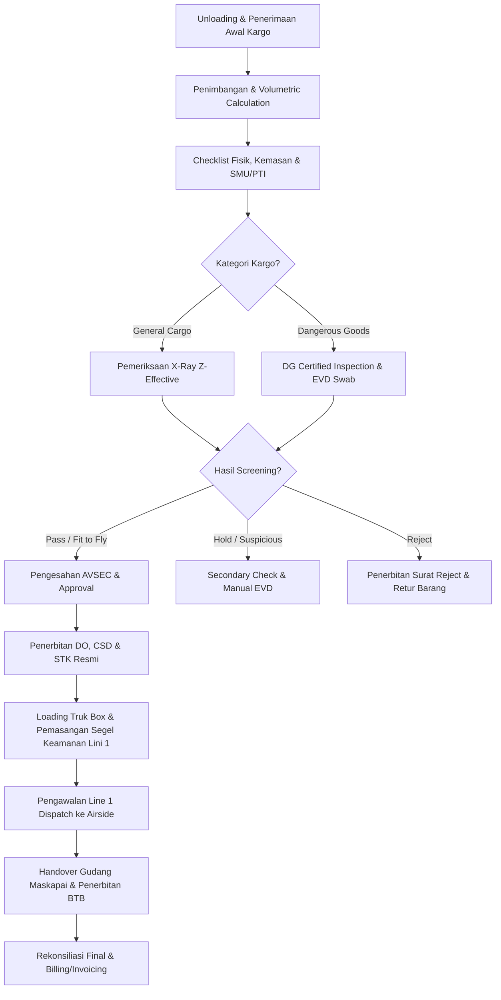

# ✈️ Gatrans Management Operations System (MOS) v1.2

[](https://react.dev/)
[](https://www.typescriptlang.org/)
[](https://tailwindcss.com/)
[](https://vitejs.dev/)
[](https://jdih.dephub.go.id/)

Sistem Manajemen Operasional & Keamanan Kargo Udara Bandara Terpadu (*Airport Cargo Security Screening, Line 1 Dispatch, Dangerous Goods Management, and Delivery Order System*). Dirancang sesuai regulasi penerbangan sipil internasional **ICAO Annex 17** dan regulasi nasional **Peraturan Menteri Perhubungan RI PM 53/2017**.

---

## 📑 Daftar Isi

- [Arsitektur & Konsep Sistem](#-arsitektur--konsep-sistem)
- [Fitur Utama & Modul Frontend yang Powerful](#-fitur-utama--modul-frontend-yang-powerful)
  - [1. Executive & Operations Command Center (Bento Grid)](#1-executive--operations-command-center-bento-grid)
  - [2. Aviation Security & Dual-Energy X-Ray Inspection Simulator](#2-aviation-security--dual-energy-x-ray-inspection-simulator)
  - [3. EVD (Explosive Trace Detector) & Pemeriksaan Lanjutan](#3-evd-explosive-trace-detector--pemeriksaan-lanjutan)
  - [4. Dangerous Goods (DG) Inspection & Disposisi Kelaikan](#4-dangerous-goods-dg-inspection--disposisi-kelaikan)
  - [5. Precision Weighing & Volumetric Calculation](#5-precision-weighing--volumetric-calculation)
  - [6. Digital Checklist & Rekonsiliasi Koli Fisik](#6-digital-checklist--rekonsiliasi-koli-fisik)
  - [7. Line 1 Dispatch, Truck Loading & Tamper-Evident Seals](#7-line-1-dispatch-truck-loading--tamper-evident-seals)
  - [8. Airside Warehouse Handover & Bukti Timbang Barang (BTB)](#8-airside-warehouse-handover--bukti-timbang-barang-btb)
  - [9. Invoicing & Billing Terintegrasi (Kasir vs Finance Kredit)](#9-invoicing--billing-terintegrasi-kasir-vs-finance-kredit)
  - [10. Official Aviation Documents Printing & PDF Export](#10-official-aviation-documents-printing--pdf-export)
  - [11. Mission-Critical Ops Center Chat & Emergency Broadcast](#11-mission-critical-ops-center-chat--emergency-broadcast)
  - [12. Zero-Trust Audit Trail & Idempotent Barcode Scanner](#12-zero-trust-audit-trail--idempotent-barcode-scanner)
- [Matriks Hak Akses (Role-Based Access Control)](#-matriks-hak-akses-role-based-access-control)
- [Alur Kerja Operasional Kargo (End-to-End Workflow)](#-alur-kerja-operasional-kargo-end-to-end-workflow)
- [Teknologi & Dependensi](#-teknologi--dependensi)
- [Struktur Direktori Proyek](#-struktur-direktori-proyek)
- [Panduan Instalasi & Menjalankan Aplikasi](#-panduan-instalasi--menjalankan-aplikasi)
- [Lisensi & Kepemilikan](#-lisensi--kepemilikan)

---

## 🏛️ Arsitektur & Konsep Sistem

Gatrans Management Operations System (MOS) menghubungkan seluruh rantai pasok kargo lini 1 bandara, mulai dari proses *unloading* awal di gudang *landside*, inspeksi ketat AVSEC, pengujian zat berbahaya, pengangkutan bersegallini 1, serah terima di gudang maskapai *airside*, hingga penerbitan dokumen resmi dan penagihan finansial.



---

## 🚀 Fitur Utama & Modul Frontend yang Powerful

Sistem ini dibangun dengan komponen UI/UX modern berbasis **React 19**, **Tailwind CSS v4**, dan **Framer Motion**, menghadirkan antarmuka ultra-responsif, interaktif, dan informatif:

### 1. Executive & Operations Command Center (Bento Grid)
- **Komponen:** `DashboardView.tsx`, `ExecutiveDashboardView.tsx`, `BentoGrid.tsx`, `MetricCards.tsx`
- **Kapabilitas:**
  - **Live Throughput Metrics:** Pemantauan real-time total tonase kargo (kg), jumlah koli/pieces diproses, dan status antrean aktif.
  - **SLA Turnaround Time Countdown:** Indikator visual real-time batas waktu keberangkatan (*departure cut-off*) per maskapai untuk mencegah keterlambatan kargo (*cargo offload*).
  - **Financial Executive KPI:** Visualisasi pendapatan harian, estimasi tagihan *handling fee*, komparasi pembayaran tunai (*cashier*) vs termin kredit (*AR Aging 14/30 days*).
  - **Airline Share Distribution:** Distribusi volume kargo per maskapai rekanan (Garuda Indonesia, Singapore Airlines, Qatar Cargo, Lion Air, dll.).

### 2. Aviation Security & Dual-Energy X-Ray Inspection Simulator
- **Komponen:** `XRayView.tsx`, `XRayModal.tsx`
- **Kapabilitas:**
  - **Simulasi Spektrum Dual-Energy (Z-Effective):** Visualisasi anomali kerapatan bahan kargo:
    - *Orange/Brown:* Material organik (makanan, bahan peledak, plastik).
    - *Blue/Green:* Logam anorganik (senjata tajam, kabel, partikel logam padat).
    - *Black/Opaque:* Material ultra padat yang tidak tertembus sinar-X (*dense shielded object*).
  - **Filter Visual Interaktif:** Pengalihan instan ke mode *Organic Strip*, *Inorganic Strip*, dan *High-Density Enhance*.
  - **Threat Class Flagging:** Identifikasi instan ancaman kargo (*Shielded Object, Hazmat/Battery, Organic Mass, Unidentified*).
  - **Multi-Piece Tracking:** Pengambilan keputusan inspeksi per-koli (PASS, HOLD, REVIEW_REQUIRED, REJECT) dengan verifikasi barcode.

### 3. EVD (Explosive Trace Detector) & Pemeriksaan Lanjutan
- **Komponen:** `AvsecView.tsx` (EVD Tab), `types/cargo.ts`
- **Kapabilitas:**
  - **Emulasi Detektor Partikel Trace (Smiths IONSCAN 600):** Pencatatan lokasi swab uji (*Handles/Latches, Cardboard Seam, Ventilation Hole, Internal Liner*).
  - **Hasil Analisis Partikulat:** Pengkategorian status *Clear (Clean)*, *Suspicious Trace*, atau *Fail Alarm (Nitro-Aromatic/Peroxide trace detected)*.
  - **Fit-to-Fly Certification:** Pengesahan kelaikan terbang oleh petugas AVSEC bersertifikat dengan nomor stamp resmi.

### 4. Dangerous Goods (DG) Inspection & Disposisi Kelaikan
- **Komponen:** `ChecklistView.tsx`, `types/cargo.ts`
- **Kapabilitas:**
  - **Klasifikasi DG IATA:** Penanganan UN Number, Proper Shipping Name, Hazard Class (Class 1 s.d. Class 9), dan Packing Group (I, II, III).
  - **Disposisi Formal:** *DG Fit to Fly*, *Data Required Hold* (menunggu kelengkapan SDS/MSDS), dan *Rejected Pending Return*.
  - **Penerbitan Surat Reject Resmi:** Pembuatan dokumen berita acara penolakan lengkap dengan kode alasan penolakan dan hak retur fisik barang kepada shipper.

### 5. Precision Weighing & Volumetric Calculation
- **Komponen:** `WeighingView.tsx`
- **Kapabilitas:**
  - **Kalkulasi Otomatis Formula IATA:** Perhitungan Gross Weight, Tare Weight, Net Weight, Volume Weight (`P × L × T / 6000`), dan Chargeable Weight otomatis.
  - **Integrasi Timbangan Digital:** Pencatatan nomor referensi timbangan terkalibrasi metrologi dan nomor tiket timbang.
  - **Deteksi Selisih Timbang (Variance Warning):** Alert visual otomatis jika terdapat selisih berat antara deklarasi awal SMU dengan timbangan aktual.

### 6. Digital Checklist & Rekonsiliasi Koli Fisik
- **Komponen:** `ChecklistView.tsx`, `PieceModal.tsx`
- **Kapabilitas:**
  - **Verifikasi Kelengkapan Dokumen:** Pemeriksaan SMU, PTI (Pemberitahuan Tentang Isi), CSD asal, dan manifest penerbangan.
  - **Kondisi Kemasan Fisik:** Penilaian standar kemasan (*Baik/Utuh, Rusak/Sobek, Segel Tidak Standar, Basah/Rembes*).
  - **Piece Reconciliation:** Validasi pencocokan jumlah koli terdaftar vs koli fisik terhitung untuk mencegah koli tertinggal.

### 7. Line 1 Dispatch, Truck Loading & Tamper-Evident Seals
- **Komponen:** `DispatchView.tsx`, `DOModal.tsx`
- **Kapabilitas:**
  - **Alokasi Armada Truk Box Lini 1:** Penugasan nomor polisi truk, kapasitas tonase, dan identitas driver berlisensi bandara.
  - **Pengawasan Segel Keamanan (Tamper-Evident):** Pencatatan nomor segel unik (*SEAL-GAT-XXXXX*) dan verifikasi integritas fisik sebelum keberangkatan dari *landside*.
  - **Pelacakan Status Pengiriman:** Status transit dinamis (*Pending Loading, Loaded & Sealed, In Transit Line 1, Arrived Airside*).

### 8. Airside Warehouse Handover & Bukti Timbang Barang (BTB)
- **Komponen:** `HandoverView.tsx`
- **Kapabilitas:**
  - **Serah Terima Kargo di Gudang Maskapai:** Pencocokan fisik di lini airside dengan petugas penerima maskapai (*airline receiving officer*).
  - **Penerbitan Dokumen BTB Resmi:** Sinkronisasi nomor BTB, jumlah koli aktual, dan berat timbang akhir.
  - **Tanda Tangan Digital & Discrepancy Protocol:** Formulir tanda tangan penerimaan digital dan pelaporan instan bila ada kerusakan segel saat pengangkutan.

### 9. Invoicing & Billing Terintegrasi (Kasir vs Finance Kredit)
- **Komponen:** `InvoicingView.tsx`
- **Kapabilitas:**
  - **Dual-Track Billing Engine:**
    - **Jalur Kasir (Cash):** Pelunasan seketika dengan bukti bayar tunai / transfer bank sebelum kargo diberangkatkan.
    - **Jalur Finance (Kredit):** Penagihan berkala untuk agen ekspedisi terdaftar dengan jatuh tempo Net 14 atau Net 30 hari.
  - **Kalkulasi Pajak & Diskon:** Perhitungan otomatis PPN 11%, rincian item penanganan (Handling Fee, X-Ray Surcharge, Storage Fee).
  - **Status Pembayaran Terpisah:** Pemisahan ketat antara kelayakan operasional kargo dengan status tagihan finansial (*Unpaid, Partially Paid, Paid, Voided*).

### 10. Official Aviation Documents Printing & PDF Export
- **Komponen:** `DocumentPrintModal.tsx`
- **Kapabilitas:**
  - **Format Cetak Standar Industri Penerbangan:**
    - **Delivery Order (DO):** Surat perintah penyerahan kargo resmi lengkap dengan barcode AWB dan rincian flight.
    - **Cargo Security Declaration (CSD):** Pernyataan keamanan kargo standar ICAO / Regulated Agent dengan status keamanan SPX (*Secure for Passenger and Cargo Aircraft*).
    - **Surat Tugas Kargo (STK):** Surat penugasan resmi untuk driver lini 1.
    - **Bukti Timbang Barang (BTB):** Lembar verifikasi berat kargo.
    - **Surat Reject Resmi:** Surat keterangan penolakan kargo demi keamanan penerbangan.
    - **Berita Acara Rekonsiliasi:** Dokumentasi resmi atas deviasi atau selisih koli.
  - **Direct Print & PDF Engine:** Layout siap cetak dengan styling CSS print media khusus tanpa terpotong (*page-break-inside avoid*).

### 11. Mission-Critical Ops Center Chat & Emergency Broadcast
- **Komponen:** `ChatView.tsx`
- **Kapabilitas:**
  - **Saluran Multi-Divisi:** Channel terdedikasi untuk *#general-ops*, *#xray-screening*, *#avsec-clearance*, *#dispatch-line1*, dan *#emergency-security*.
  - **AWB Deep-Linking:** Penandaan otomatis nomor AWB dalam chat yang dapat diklik langsung untuk membuka detail konsinyasi.
  - **Emergency Broadcast Alert:** Mode siaran darurat visual dengan badge prioritas tinggi (*Critical Alert*) untuk insiden keamanan.
  - **Quick Macro Responses:** Template jawaban cepat operasional standar (*Kargo ditahan, X-Ray clear, Truk berangkat, Dokumen belum lengkap*).

### 12. Zero-Trust Audit Trail & Idempotent Barcode Scanner
- **Komponen:** `AuditView.tsx`, `ScannerModal.tsx`, `AuditModal.tsx`
- **Kapabilitas:**
  - **Log Audit Imutabel Terenkripsi:** Rekam jejak kronologis setiap aksi pengguna (waktu, ID pengguna, peran, aksi, nomor AWB, dan diff perubahan data).
  - **Scanner Barcode/QR Interaktif:** Simulator kamera dan keyboard scanner dengan feedback suara dan visual (*beep success/error sound*).
  - **Idempotent Scanning:** Pencegahan pemindaian ganda (*double scan prevention*) untuk menjamin integritas data koli kargo.

---

## 👥 Matriks Hak Akses (Role-Based Access Control)

| Modul / Fitur | SUPERADMIN | MANAGERIAL | ADMIN CSD | CHECKER | OPERATOR X-RAY | HANDLER | DRIVER LINI 1 |
|:---|:---:|:---:|:---:|:---:|:---:|:---:|:---:|
| **Executive & Finance KPI** | ✅ | ✅ | ❌ | ❌ | ❌ | ❌ | ❌ |
| **Penerimaan & Form Checker** | ✅ | ❌ | ✅ | ✅ | ❌ | ❌ | ❌ |
| **X-Ray Screening & Simulator** | ✅ | ❌ | ❌ | ❌ | ✅ | ❌ | ❌ |
| **EVD Swab & AVSEC Record** | ✅ | ❌ | ✅ | ✅ | ❌ | ❌ | ❌ |
| **Penimbangan Kargo** | ✅ | ❌ | ✅ | ✅ | ❌ | ✅ | ❌ |
| **Penerbitan DO & CSD** | ✅ | ❌ | ✅ | ❌ | ❌ | ❌ | ❌ |
| **Loading & Pasang Segel** | ✅ | ❌ | ❌ | ❌ | ❌ | ✅ | ❌ |
| **Line 1 Driver Transit** | ✅ | ❌ | ❌ | ❌ | ❌ | ❌ | ✅ |
| **Handover Gudang Maskapai** | ✅ | ❌ | ✅ | ✅ | ❌ | ❌ | ✅ |
| **Kasir & Invoicing** | ✅ | ✅ | ✅ | ❌ | ❌ | ❌ | ❌ |
| **Audit Trail Log** | ✅ | ✅ | ❌ | ❌ | ❌ | ❌ | ❌ |

---

## 🔄 Alur Kerja Operasional Kargo (End-to-End Workflow)

1. **Tahap 1: Unloading & Intake Registrasi**
   - Kargo tiba di area *unloading landside* Gatrans dari pihak ekspedisi / shipper.
   - Admin/Checker mencocokkan dokumen SMU (Surat Muatan Udara) dan PTI (Pemberitahuan Tentang Isi).
2. **Tahap 2: Penimbangan & Pengukuran Dimensi**
   - Kargo ditimbang pada timbangan bersertifikasi; sistem menghitung *Volumetric & Chargeable Weight*.
3. **Tahap 3: Pemeriksaan Keamanan Kargo (X-Ray & EVD)**
   - Koli kargo melalui terowongan *dual-energy X-Ray scanner*. Operator menganalisis spektrum warna bahan.
   - Bila terindikasi anomali, kargo dialihkan ke pemeriksaan sekunder dengan swab *Explosive Trace Detector (EVD)*.
4. **Tahap 4: Pengesahan AVSEC & Penerbitan Dokumen**
   - Petugas AVSEC memvalidasi kelaikan terbang (*Fit-to-Fly Confirmation*).
   - Sistem mencetak otomatis CSD (*Cargo Security Declaration*), Delivery Order (DO), dan STK.
5. **Tahap 5: Loading & Penyegelan Truk Box Lini 1**
   - Kargo dimuat ke dalam armada tertutup lini 1; nomor segel *tamper-evident* dicatat dan diverifikasi.
6. **Tahap 6: Pengawalan & Serah Terima Airside**
   - Driver melintasi pos keamanan menuju gudang maskapai di lini airside.
   - Petugas maskapai memverifikasi segel kargo, melakukan timbang ulang, dan menerbitkan Bukti Timbang Barang (BTB).
7. **Tahap 7: Rekonsiliasi & Penagihan (Billing)**
   - Seluruh data disinkronkan, status kargo diperbarui menjadi *Delivered*, dan invoice diterbitkan kepada shipper/agen.

---

## 💻 Teknologi & Dependensi

- **Frontend Core:** [React 19](https://react.dev/) & [TypeScript](https://www.typescriptlang.org/)
- **Build Tool:** [Vite 8](https://vitejs.dev/)
- **Styling:** [Tailwind CSS v4](https://tailwindcss.com/) dengan dukungan CSS variable tokens
- **Animations & Transitions:** [Motion (Framer Motion v12)](https://motion.dev/)
- **Iconography:** [Lucide React](https://lucide.dev/) (koleksi ikon modern & konsisten)
- **AI Integration Support:** [@google/genai](https://www.npmjs.com/package/@google/genai)
- **Multilingual (i18n):** Bahasa Indonesia & English toggle support

---

## 📁 Struktur Direktori Proyek

```text
GATRANS/
├── src/
│   ├── components/
│   │   ├── views/                  # 17 Modul Tampilan Utama Operasional
│   │   │   ├── DashboardView.tsx           # Operasional Live Dashboard
│   │   │   ├── ExecutiveDashboardView.tsx  # Executive & Financial Analytics
│   │   │   ├── ConsignmentsView.tsx        # Manajemen Master Konsinyasi AWB
│   │   │   ├── WeighingView.tsx            # Penimbangan & Volumetric Weight
│   │   │   ├── ChecklistView.tsx           # Checklist Fisik, SMU/PTI & DG
│   │   │   ├── XRayView.tsx                # Dual-Energy X-Ray Screening
│   │   │   ├── AvsecView.tsx               # EVD Swab & Fit-to-Fly Approval
│   │   │   ├── DispatchView.tsx            # Line 1 Truck Loading & Segel
│   │   │   ├── HandoverView.tsx            # Airline Handover & Bukti BTB
│   │   │   ├── InvoicingView.tsx           # Kasir Cash & Finance Invoicing
│   │   │   ├── ExceptionsView.tsx          # Manajemen Insiden & Discrepancy
│   │   │   ├── ChatView.tsx                # Ops Center Messaging & Broadcast
│   │   │   ├── AuditView.tsx               # Immutable Security Audit Logs
│   │   │   ├── ShiftView.tsx               # Shift Roster & Serah Terima Jaga
│   │   │   ├── ReportsView.tsx             # Laporan Harian & Analitik Kinerja
│   │   │   └── PolicyView.tsx              # Standar Regulasi ICAO & PM 53/2017
│   │   ├── BentoGrid.tsx           # Komponen Layout Bento Interaktif
│   │   ├── MetricCards.tsx         # Kartu Metrik Indikator Kinerja Utama
│   │   ├── DocumentPrintModal.tsx  # Generator Dokumen Resmi & Print PDF
│   │   ├── XRayModal.tsx           # Simulator X-Ray Z-Effective Terperinci
│   │   ├── ScannerModal.tsx        # Barcode & QR Code Scanner Interaktif
│   │   ├── DOModal.tsx             # Modal Penerbitan Delivery Order
│   │   ├── PieceModal.tsx          # Modal Rincian Koli & Barcode
│   │   ├── ShiftModal.tsx          # Modal Pergantian Shift Operasional
│   │   ├── ExceptionModal.tsx      # Modal Investigasi Kasus Pengecualian
│   │   ├── Header.tsx              # Header Navigasi & Selector Role
│   │   ├── Sidebar.tsx             # Navigasi Menu Samping Terstruktur
│   │   └── MobileBottomNav.tsx     # Navigasi Bawah Khusus Smartphone/Tablet
│   ├── types/
│   │   └── cargo.ts                # Master Model Tipe Data & Skema Kargo
│   ├── i18n/
│   │   └── translations.ts         # Kamus Penerjemahan Bahasa (ID / EN)
│   ├── index.css                   # Tailwind v4 Theme Tokens & Print CSS
│   ├── App.tsx                     # Entrypoint State & Role Switcher
│   └── main.tsx                    # React Root Mounting
├── index.html                      # Template Utama Aplikasi Web
├── package.json                    # Dependensi & Skrip Proyek
└── README.md                       # Dokumentasi Komprehensif Sistem
```

---

## 🛠️ Panduan Instalasi & Menjalankan Aplikasi

### 1. Prasyarat Sistem
- **Node.js:** Versi 18.0 ke atas disarankan
- **npm:** Versi 9.0 ke atas
- Browser modern (Chrome, Edge, Firefox, Safari)

### 2. Kloning & Pemasangan Dependensi
```bash
# Clone repository
git clone https://github.com/AnfalBlank/systeminternalgatrans.git

# Masuk ke direktori proyek
cd systeminternalgatrans

# Install seluruh dependensi
npm install
```

### 3. Menjalankan Server Pengembangan (Development Mode)
```bash
npm run dev
```
Setelah server berjalan, buka browser di:
👉 **`http://localhost:3000/`**

### 4. Build untuk Lingkungan Produksi
```bash
npm run build
```
Hasil build siap *deploy* akan tersedia pada direktori `/dist`.

---

## 📜 Lisensi & Kepemilikan

Hak Cipta © 2026 **PT. Manggala Utama Indonesia**. Seluruh hak cipta dilindungi undang-undang.  
Dikembangkan untuk pengoperasian internal **Gatrans Management Operations System (MOS)**.
