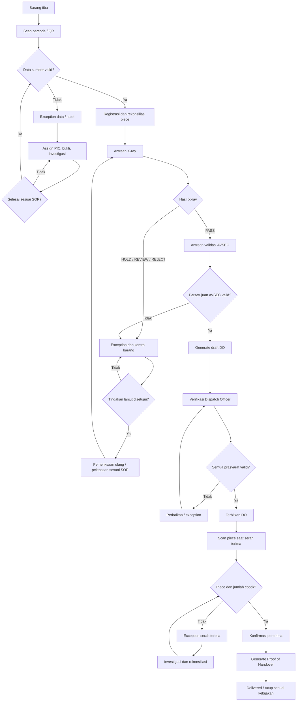

# PRODUCT REQUIREMENTS DOCUMENT (PRD)
## Airport Cargo Security & Dispatch Management System

- **Versi:** 1.2
- **Status:** Baseline untuk review, development, QA, dan UAT
- **Bahasa:** Indonesia
- **Dokumen:** PRD lengkap terintegrasi

---

## 1. Ringkasan Eksekutif

Airport Cargo Security & Dispatch Management System adalah aplikasi operasional untuk mengelola penerimaan kargo, pencocokan data berdasarkan barcode/QR, pemeriksaan X-ray, validasi AVSEC, pembuatan dan penerbitan Delivery Order (DO), pelacakan unit fisik (*piece-level tracking*), penanganan exception/insiden, serah terima ke gudang maskapai, bukti serah terima digital, pergantian shift, serta pemantauan SLA.

Sistem harus menyediakan jejak audit dari awal hingga akhir. Sistem tidak boleh mengizinkan proses dispatch melewati kontrol keamanan atau mengubah status barang menjadi `DELIVERED` hanya karena DO telah diterbitkan.

### 1.1 Tujuan bisnis
- Menyatukan proses operasional kargo dalam alur yang dapat dipantau.
- Mengurangi input ulang melalui scan barcode/QR dan pengisian data dari sumber terverifikasi.
- Memastikan hasil X-ray dan keputusan AVSEC tercatat serta terikat pada data yang tepat.
- Mengendalikan pembuatan draft DO, verifikasi, dan penerbitan DO.
- Melacak setiap unit fisik, bukan hanya jumlah total konsinyasi.
- Mengelola hold, reject, ketidaksesuaian, dan insiden melalui exception case.
- Menyediakan bukti digital serah terima ke gudang maskapai.
- Menjaga kontinuitas operasional saat pergantian shift atau gangguan sistem.
- Menyediakan dashboard, laporan, SLA, dan audit trail.

### 1.2 Prinsip desain
1. **Security first:** tidak ada bypass atas kontrol keamanan wajib.
2. **Traceability:** setiap status penting dapat ditelusuri ke aktor, waktu, data, dan bukti.
3. **Piece-level accountability:** identitas unit fisik dan kuantitas sama-sama direkonsiliasi.
4. **Separation of duties:** kewenangan dipisahkan sesuai SOP.
5. **Fail safe:** data/kontrol yang tidak dapat diverifikasi tidak dianggap lulus.
6. **Idempotency:** scan atau request berulang tidak membuat transaksi ganda.
7. **Configurable SOP:** SLA dan aturan operasional ditentukan pemilik proses.
8. **Evidence integrity:** bukti dilindungi melalui kontrol akses dan riwayat perubahan.

---

## 2. Ruang Lingkup

### 2.1 Termasuk dalam ruang lingkup
- Autentikasi, RBAC, dan manajemen pengguna.
- Penerimaan kargo dan scan barcode/QR.
- Lookup data konsinyasi/CSD dari sumber terverifikasi.
- Registrasi dan pelacakan piece/unit fisik.
- Antrean dan hasil pemeriksaan X-ray.
- Hold, reject, pemeriksaan ulang, exception, dan insiden.
- Validasi AVSEC yang terikat pada versi data.
- Pembuatan otomatis draft DO setelah prasyarat terpenuhi.
- Verifikasi dan penerbitan DO oleh Dispatch Officer.
- Rekonsiliasi sebelum serah terima.
- Digital Proof of Handover ke gudang maskapai.
- Shift handover dan logbook.
- SLA monitoring, peringatan, dan eskalasi.
- Dashboard, laporan, pencarian, dan ekspor sesuai izin.
- Audit trail, histori status, backup, pemulihan, dan monitoring teknis.

### 2.2 Di luar ruang lingkup baseline
- Mengendalikan perangkat X-ray atau membuat keputusan keamanan otomatis.
- Menggantikan SOP dan penilaian profesional AVSEC.
- Integrasi sistem maskapai, CSD, atau bandara sebelum spesifikasi dan akses tersedia.
- Pembayaran, invoice komersial, tarif kargo, dan revenue management.
- GPS/IoT real-time kecuali disetujui sebagai fase lanjutan.
- AI untuk menentukan hasil X-ray.
- Menetapkan SLA, retensi data, atau aturan pemeriksaan yang belum disahkan pemilik proses.

---

## 3. Pengguna, Peran, dan Hak Akses

| Peran | Tanggung jawab |
|---|---|
| Receiving Admin | Scan label, mencocokkan data sumber, mencatat penerimaan dan jumlah awal |
| X-ray Operator | Memproses antrean pemeriksaan dan merekam hasil sesuai SOP |
| AVSEC Officer | Meninjau data/hasil dan mencatat keputusan keamanan |
| Dispatch Officer | Memverifikasi draft DO, menerbitkan DO, menyiapkan dispatch |
| Warehouse Receiver | Memverifikasi piece dan mengonfirmasi serah terima fisik |
| Shift Supervisor | Memantau operasi, menangani eskalasi, meninjau handover |
| Operations Manager | Mengelola kebijakan operasional, dashboard, laporan, dan SLA |
| System Administrator | Mengelola konfigurasi teknis, pengguna, integrasi, kesehatan sistem |
| Auditor/Compliance | Membaca catatan, bukti, histori, dan laporan audit sesuai cakupan akses |

### 3.1 Prinsip otorisasi
- Terapkan *least privilege* dan pembatasan berdasarkan role, lokasi, shift, status, serta tindakan.
- Persetujuan keamanan dan penerbitan dokumen hanya dilakukan peran berwenang.
- Terapkan pemisahan tugas jika diwajibkan SOP.
- Administrator tidak otomatis memiliki kewenangan AVSEC atau penerbit DO.
- Akun bersama tidak diperbolehkan untuk tindakan kritis.
- Perubahan role dan hak istimewa harus tercatat.
- Pengguna yang dinonaktifkan tidak dapat membuat transaksi baru; histori tetap dipertahankan.

---

## 4. Alur Operasional End-to-End

### 4.1 Penerimaan dan lookup data
1. Receiving Admin memindai barcode/QR.
2. Sistem memvalidasi format dan mencari data pada sumber terintegrasi/registri yang disetujui.
3. Sistem hanya mengisi field yang benar-benar tersedia dan terverifikasi. Jika barcode hanya berisi ID, ID digunakan untuk lookup; field lain tidak boleh ditebak.
4. Data tidak ditemukan, konflik, atau tidak lengkap diarahkan ke exception.
5. Sistem mencatat aktor, waktu, stasiun/lokasi jika dikonfigurasi, dan hasil lookup.

### 4.2 Registrasi piece
1. Sistem mencatat jumlah piece yang direncanakan dan diterima.
2. Setiap unit fisik mendapatkan ID internal unik; barcode piece dapat dicetak bila perangkat dan SOP mendukung.
3. Piece tanpa identitas yang dapat diverifikasi tidak dianggap cocok hanya berdasarkan jumlah.

### 4.3 Pemeriksaan X-ray
1. Piece/konsinyasi masuk antrean sesuai SOP.
2. Operator memindai atau memilih unit yang tepat sebelum memasukkan hasil.
3. Hasil memakai daftar status terkontrol, misalnya `PASS`, `HOLD`, `REJECT`, atau `REVIEW_REQUIRED`; nilai final ditentukan SOP.
4. Hasil mencatat operator, waktu, catatan, stasiun/perangkat bila tersedia, versi data, dan referensi bukti.
5. Hasil non-pass tidak boleh dianggap lulus.
6. Pemeriksaan ulang menjadi catatan baru; hasil sebelumnya tetap tersimpan.

### 4.4 Penanganan hold/reject/insiden
1. Sistem membuat exception berisi kategori, alasan, prioritas, PIC, status, tenggat, bukti, dan kronologi.
2. Barang tetap dalam status terkendali sesuai SOP.
3. Pemeriksaan ulang atau pelepasan hanya dilakukan peran berwenang berdasarkan SOP.
4. Resolusi dan penutupan case harus memiliki bukti/catatan yang sesuai.

### 4.5 Validasi AVSEC
1. Item yang memenuhi prasyarat masuk antrean AVSEC.
2. AVSEC meninjau data konsinyasi, identitas piece, hasil pemeriksaan, dan exception terkait.
3. Keputusan terikat pada versi data yang ditinjau.
4. Perubahan data kritis setelah persetujuan memicu invalidasi atau review ulang sesuai matriks perubahan yang disahkan.
5. Keputusan, alasan, aktor, waktu, dan versi data dicatat.

### 4.6 Pembuatan dan penerbitan DO
1. Setelah persetujuan AVSEC valid dan prasyarat lain terpenuhi, sistem membuat draft DO otomatis.
2. Draft mempunyai nomor referensi unik sesuai konfigurasi.
3. Dispatch Officer memverifikasi data DO, status keamanan, exception pemblokir, dan rekonsiliasi piece.
4. Jika semua valid, Dispatch Officer menerbitkan DO.
5. Draft tidak boleh dianggap dokumen final atau izin dispatch.
6. Amend/cancel DO yang sudah terbit mengikuti proses berwenang dan mempertahankan histori versi sebelumnya.

### 4.7 Serah terima ke gudang maskapai
1. Handover harus terkait DO yang telah terbit.
2. Petugas memindai piece terhadap daftar DO.
3. Sistem memeriksa identitas dan jumlah aktual.
4. Catat pihak penyerah/penerima, waktu, lokasi jika tersedia, kondisi barang, konfirmasi/tanda tangan digital sesuai kebijakan, dan lampiran.
5. Selisih, kerusakan, piece hilang, atau identitas tidak cocok membuat exception dan mencegah penutupan otomatis.
6. `DELIVERED` hanya diberikan setelah seluruh syarat serah terima yang disahkan terpenuhi.

### 4.8 Penutupan dan pelaporan
- Sistem menyimpan Digital Proof of Handover (PoH).
- Konsinyasi dan exception ditutup berdasarkan aturan, bukan hanya karena proses berikutnya dimulai.
- Dashboard dan laporan menggunakan catatan transaksi sumber.

### 4.9 Diagram alur

SLA, audit trail, dan shift handover berjalan lintas tahapan; ketiganya tidak boleh mengesampingkan kontrol keamanan.

---

## 5. Status dan State Machine

### 5.1 Status konsinyasi
- `RECEIVED`
- `DATA_EXCEPTION`
- `PIECE_RECONCILIATION`
- `AWAITING_XRAY`
- `XRAY_HOLD`
- `XRAY_REVIEW_REQUIRED`
- `XRAY_REJECTED`
- `AWAITING_AVSEC`
- `AVSEC_REJECTED_OR_HELD`
- `AVSEC_APPROVED`
- `DO_DRAFT`
- `DO_ISSUED`
- `AWAITING_WAREHOUSE_HANDOVER`
- `HANDOVER_DISCREPANCY`
- `DELIVERED`
- `CANCELLED` (hanya jika kebijakan dan kewenangan mengizinkan)

Status final dan transisi harus disesuaikan dengan SOP resmi. Status tidak boleh diubah bebas melalui form administrasi.

### 5.2 Status piece
- `REGISTERED`
- `RECEIVED`
- `AWAITING_XRAY`
- `XRAY_PASS`
- `XRAY_HOLD`
- `XRAY_REVIEW_REQUIRED`
- `XRAY_REJECTED`
- `AVSEC_PENDING`
- `AVSEC_APPROVED`
- `DO_ASSIGNED`
- `HANDED_OVER`
- `DISCREPANCY`
- `CANCELLED` (dengan otorisasi dan alasan)

Setiap perubahan status menghasilkan event histori. Piece tidak boleh melewati kontrol wajib.

### 5.3 Status exception
- `OPEN`
- `ASSIGNED`
- `IN_PROGRESS`
- `PENDING_REVIEW`
- `RESOLVED`
- `CLOSED`

`RESOLVED` berarti penyelesaian diajukan/dilakukan. `CLOSED` hanya dapat dilakukan pihak berwenang setelah kriteria penutupan terpenuhi.

### 5.4 Status DO
- `DRAFT`
- `PENDING_VERIFICATION`
- `ISSUED`
- `AMENDED` atau versi revisi yang terkait
- `CANCELLED` jika dibatalkan secara sah

Draft bukan DO terbit. Semua versi harus dapat ditelusuri.

---

## 6. Kebutuhan Fungsional

### FR-01 — Autentikasi dan sesi
- Pengguna masuk menggunakan akun individual.
- Sistem menerapkan kebijakan password dan sesi organisasi.
- Sesi tidak valid ditolak; akun dinonaktifkan tidak dapat membuat transaksi baru.
- Autentikasi ulang dapat diwajibkan untuk tindakan berisiko tinggi.

### FR-02 — Pengguna dan role
- Pengguna berwenang dapat membuat, mengubah, atau menonaktifkan akun serta menetapkan role.
- Izin diperiksa di backend pada setiap tindakan kritis.
- Perubahan role tercatat.
- Role tidak memberi izin lintas fungsi secara implisit.

### FR-03 — Penerimaan dan scan barcode/QR
- Mendukung scanner USB/Bluetooth mode keyboard wedge bila kompatibel.
- Input manual dapat menjadi fallback terbatas; alasan dicatat jika disyaratkan SOP.
- Memvalidasi format, duplikasi, dan keberadaan ID.
- Lookup hanya dari sumber yang disetujui.
- Menampilkan status validasi dan sumber data bila tersedia.
- Tidak menebak field yang tidak tersedia.
- Menyediakan exception untuk label rusak/tidak terbaca atau data tidak ditemukan.

### FR-04 — Konsinyasi dan CSD
- Menampilkan data konsinyasi/CSD yang relevan dari sumber terverifikasi.
- Menyimpan referensi sumber dan waktu lookup/sinkronisasi.
- Menandai field wajib kosong atau konflik.
- Perubahan field kritis menyimpan nilai sebelum/sesudah dan alasan.
- Sistem sumber resmi, pemetaan field, dan metode integrasi ditetapkan dalam desain integrasi.

### FR-05 — Piece-level tracking
- Satu konsinyasi dapat memiliki banyak piece.
- Setiap piece memiliki ID internal unik dan dapat memiliki barcode sendiri.
- Mencatat jumlah direncanakan, diterima, diperiksa, disetujui, tercantum di DO, dan diserahkan.
- Memeriksa identitas piece, bukan hanya jumlah.
- Mencegah piece dihitung dua kali pada tahap yang sama.
- Mendeteksi piece hilang, ekstra, tertukar, duplikat, atau belum melewati pemeriksaan wajib.
- Partial handover hanya jika kebijakan mengizinkan dan kontrolnya dikonfigurasi.

### FR-06 — Antrean dan hasil X-ray
- Antrean dapat diurutkan menurut prioritas, status, dan waktu tunggu.
- Operator memilih/memindai unit sebelum mencatat hasil.
- Hasil memakai nilai terkontrol yang disetujui pemilik SOP.
- Catatan mencakup operator, timestamp, catatan, stasiun/perangkat bila tersedia, versi data, dan bukti.
- Hasil non-pass memicu status terkendali dan/atau exception.
- Pemeriksaan ulang mempertahankan hasil terdahulu.
- Perubahan hasil dibatasi pada peran berwenang dengan alasan dan audit.

### FR-07 — Exception & Incident Management
Kategori awal:
- Barcode tidak dikenal/tidak terbaca.
- Data CSD tidak cocok/tidak lengkap.
- X-ray hold, review, atau reject.
- Label atau identitas piece bermasalah.
- Piece hilang, ekstra, atau duplikat.
- AVSEC pending/ditolak.
- Kesalahan DO.
- Selisih/kerusakan saat handover.
- Kegagalan perangkat, jaringan, atau integrasi.
- Insiden operasional lain yang disetujui.

Setiap case memuat nomor unik, kategori, alasan, prioritas, status, referensi konsinyasi/piece/DO, PIC, waktu dibuat, tenggat, bukti, kronologi tindakan, resolusi, pihak penyelesai, dan persetujuan penutupan bila diperlukan.

### FR-08 — Validasi AVSEC
- Menyediakan antrean bagi item yang memenuhi syarat.
- Menampilkan data dan hasil pemeriksaan yang menjadi dasar keputusan.
- Keputusan hanya dapat dibuat AVSEC berwenang.
- Mencatat status, waktu, aktor, alasan, dan versi data yang ditinjau.
- Memblokir keputusan bila pemeriksaan atau data wajib belum ada.
- Perubahan kritis setelah persetujuan memicu invalidasi/review sesuai matriks perubahan.
- SLA overdue hanya menghasilkan peringatan/eskalasi, bukan auto-approval.

### FR-09 — Draft, verifikasi, dan penerbitan DO
- Sistem membuat draft setelah prasyarat terpenuhi.
- Nomor DO unik dan aman terhadap retry.
- Dispatch Officer memverifikasi sebelum penerbitan.
- Penerbitan memeriksa AVSEC, exception pemblokir, rekonsiliasi piece, dan field wajib.
- Menyimpan versi, aktor, waktu, dan alasan perubahan.
- Amend/cancel setelah terbit mengikuti prosedur resmi.
- Mendukung PDF sesuai template yang disetujui.

### FR-10 — Warehouse handover dan Digital Proof of Handover
- Handover terkait DO berstatus `ISSUED`.
- Piece dipindai terhadap daftar DO.
- Identitas dan jumlah aktual direkonsiliasi.
- Mencatat pihak, waktu, lokasi bila tersedia, kondisi, catatan, konfirmasi/tanda tangan digital sesuai kebijakan, dan lampiran.
- Expected count dan actual count dicatat.
- Selisih membuat exception dan mencegah auto-close.
- PoH memiliki nomor unik, referensi DO, piece, pihak, waktu, dan versi.
- PDF PoH dapat dihasilkan.
- Koreksi PoH menjadi revisi/event baru; bukti lama tidak dihapus diam-diam.

### FR-11 — Shift handover dan logbook
- Menampilkan pekerjaan terbuka sebelum shift berakhir.
- Meliputi exception, reject/hold, antrean X-ray, AVSEC pending, draft DO, DO belum diserahkan, dan mismatch gudang.
- Mencatat shift, lokasi, petugas outgoing/incoming, catatan, waktu, status, dan acknowledgment.
- Supervisor meninjau sesuai kebijakan.
- Case tetap terbuka setelah pergantian shift.
- Perubahan setelah acknowledgment menjadi event baru.
- Handover tidak mengubah status keamanan atau menutup case otomatis.

### FR-12 — SLA monitoring dan eskalasi
- SLA dapat dikonfigurasi per tahap/kategori.
- Policy menentukan event mulai/selesai, target, warning, escalation, kalender/shift, penerima, dan aturan pause.
- Memisahkan waktu tunggu, pengerjaan aktif, exception, dan pause yang diizinkan jika data tersedia.
- Mengirim warning sebelum jatuh tempo dan eskalasi setelah overdue.
- Mencatat hasil pengiriman notifikasi.
- SLA tidak melewati kontrol keamanan atau menutup case otomatis.
- Target numerik harus disahkan pemilik proses; PRD ini tidak mengarang nilainya.

### FR-13 — Dashboard dan laporan
Dashboard minimal:
- Volume kargo diterima per periode.
- Antrean X-ray dan umur antrean.
- Status validasi AVSEC.
- DO draft, pending verification, issued, dan cancelled.
- Konsinyasi/piece belum direkonsiliasi.
- Exception per kategori, prioritas, status, PIC, dan umur.
- SLA warning/overdue per tahap.
- Shift handover yang menunggu acknowledgment.
- DO versus aktual serah terima.
- Delivered dan ketersediaan PoH.
- Tren waktu penyelesaian dan penyebab exception.

Laporan dapat difilter berdasarkan periode, AWB/CSD, barcode, piece ID, DO, status, kategori, PIC, shift, maskapai/gudang jika tersedia, dan lokasi. Ekspor mengikuti izin role dan dapat dicatat bila mengandung data sensitif.

### FR-14 — Pencarian dan histori
- Pencarian berdasarkan ID konsinyasi/AWB/CSD, barcode, piece ID, DO, exception ID, dan PoH ID.
- Detail menampilkan timeline penerimaan, pemeriksaan, AVSEC, DO, exception, shift, dan handover.
- Histori menunjukkan aktor, waktu, tindakan, hasil, dan referensi bukti.
- Akses data mengikuti role/lokasi.

### FR-15 — Notifikasi
- Notifikasi dalam aplikasi untuk assignment exception, SLA warning/overdue, review AVSEC, verifikasi DO, dan handover.
- Email/SMS/WhatsApp hanya setelah provider dan integrasi ditentukan.
- Isi notifikasi meminimalkan data sensitif.
- Kegagalan notifikasi dicatat dan tidak mengubah status transaksi.

### FR-16 — Konfigurasi dan master data
- Mengelola lokasi/stasiun, shift, alasan, kategori exception, prioritas, role, template DO/PoH, SLA policy, dan aturan status.
- Perubahan konfigurasi kritis dibatasi dan diaudit.
- Konfigurasi memiliki versi, waktu efektif, dan pembuat.
- Perubahan policy tidak mengubah histori lama tanpa proses migrasi yang disetujui.

### FR-17 — Audit trail
- Catat perubahan role/master data, hasil X-ray, keputusan AVSEC, DO, status, exception, penutupan case, PoH, dan konfigurasi.
- Simpan nilai sebelum/sesudah bila relevan.
- Pengguna biasa tidak dapat mengedit/menghapus audit event.
- Akses audit log dibatasi dan dapat dicatat.
- Waktu disimpan konsisten dan ditampilkan menurut zona waktu operasional.

### FR-18 — Gangguan dan pemulihan
- Menampilkan gangguan perangkat, jaringan, atau integrasi.
- Menahan tindakan kritis jika prasyarat tidak dapat diverifikasi.
- Prosedur manual darurat harus ditetapkan organisasi, termasuk referensi sementara dan rekonsiliasi pascapemulihan.
- Mendukung retry aman dengan idempotency key.
- Menyediakan backup, uji restore, monitoring error, dan prosedur pemulihan.
- Request timeout harus diverifikasi sebelum dinyatakan gagal/berhasil.

---

## 7. Kriteria Kritis (Critical Requirements)

Seluruh CR berikut berstatus **P0 — wajib sebelum produksi**. Kegagalan salah satu kontrol menggagalkan UAT rilis terkait.

| ID | Kriteria kritis | Aturan wajib |
|---|---|---|
| CR-01 | Validasi AVSEC wajib | DO tidak dapat diterbitkan tanpa persetujuan AVSEC valid yang sesuai versi data dan pemeriksaan berlaku. |
| CR-02 | Integritas barcode/data | Barcode tidak dikenal, duplikat, tidak cocok, atau tidak terverifikasi tidak otomatis valid; arahkan ke exception. |
| CR-03 | Integritas X-ray | Hold/review/reject tidak dianggap pass; pemeriksaan ulang mengikuti SOP dan mempertahankan hasil sebelumnya. |
| CR-04 | Rekonsiliasi per piece | Jumlah total cocok saja tidak cukup; identitas piece yang diwajibkan harus cocok dan melewati pemeriksaan. |
| CR-05 | Draft berbeda dari DO terbit | Draft bukan dokumen final; penerbitan hanya oleh Dispatch Officer berwenang setelah prasyarat diperiksa. |
| CR-06 | Exception tidak boleh hilang | Setiap exception memiliki nomor, alasan, status, PIC, kronologi, dan bukti/resolusi sesuai kategori. |
| CR-07 | Bukti serah terima terverifikasi | Delivered tidak ditetapkan hanya dari DO terbit; syarat handover harus terpenuhi. |
| CR-08 | Hak akses dan separation of duties | Tindakan kritis hanya dapat dilakukan role berwenang; konflik tugas yang dilarang SOP dicegah. |
| CR-09 | Audit trail terlindungi | Pengguna biasa tidak dapat mengubah/menghapus audit log; koreksi dicatat sebagai event baru. |
| CR-10 | Konsistensi/idempotensi | Retry, double scan, atau request berulang tidak menghasilkan DO, PoH, atau transaksi ganda. |
| CR-11 | SLA tidak melewati keamanan | Overdue hanya memicu warning/escalation; tidak ada auto-pass, auto-approval, auto-issue, atau auto-close. |
| CR-12 | Pemulihan aman | Jika status/data/bukti tidak dapat diverifikasi, transisi kritis diblokir; pemulihan tidak menghilangkan/menggandakan transaksi. |

### 7.1 Aturan implementasi wajib
1. Kontrol kritis ditegakkan di backend dan database, bukan hanya pada UI.
2. Perubahan status dan event audit terkait diproses secara konsisten/atomik.
3. Keputusan dan hasil pemeriksaan terikat pada versi data yang tepat.
4. Lampiran memiliki kontrol akses, metadata, dan checksum bila sesuai.
5. QA melakukan negative testing untuk bypass, akses tanpa izin, scan duplikat, mismatch, dan gangguan jaringan.
6. SOP menjadi sumber aturan untuk hasil pemeriksaan, pemeriksaan ulang, partial handover, SLA, dan penutupan case.

---

## 8. Model Data Konseptual

Model ini konseptual dan perlu ditinjau sebelum produksi.

| Entitas/tabel | Tujuan | Field utama yang disarankan |
|---|---|---|
| `users` | Akun | `id`, `name`, `username`, `status`, timestamps |
| `roles` | Role | `id`, `code`, `name` |
| `user_roles` | Pemetaan user-role | `user_id`, `role_id`, `scope_id` |
| `locations` | Lokasi/stasiun | `id`, `code`, `name`, `status` |
| `consignments` | Konsinyasi | `id`, `source_reference`, `awb_or_csd`, `status`, `source_version`, timestamps |
| `consignment_source_snapshots` | Snapshot sumber | `id`, `consignment_id`, `source_system`, `source_key`, `payload_reference`, `retrieved_at`, `version` |
| `consignment_pieces` | Unit fisik | `id`, `consignment_id`, `piece_no`, `barcode_value`, `status`, timestamps |
| `scan_events` | Catatan scan | `id`, `piece_id`, `consignment_id`, `scan_type`, `station_id`, `actor_id`, `scanned_at`, `idempotency_key` |
| `xray_inspections` | Hasil X-ray | `id`, `piece_id`/`consignment_id`, `result`, `operator_id`, `inspected_at`, `notes`, `data_version` |
| `avsec_reviews` | Keputusan AVSEC | `id`, `consignment_id`, `decision`, `officer_id`, `decided_at`, `reviewed_data_version`, `reason` |
| `delivery_orders` | DO | `id`, `do_number`, `consignment_id`, `status`, `version`, `issued_by`, `issued_at` |
| `delivery_order_items` | Isi DO | `id`, `do_id`, `piece_id` atau referensi item, kuantitas sesuai model |
| `exception_cases` | Exception | `id`, `case_no`, `category`, `reason_code`, `priority`, `status`, referensi objek, `assigned_to`, `due_at`, timestamps |
| `exception_actions` | Kronologi exception | `id`, `exception_id`, `action_type`, `notes`, `actor_id`, `created_at` |
| `attachments` | Bukti | `id`, `storage_key`, `filename`, `mime_type`, `size`, `checksum`, `uploaded_by`, `created_at` |
| `attachment_links` | Relasi bukti | `attachment_id`, `entity_type`, `entity_id`, `purpose` |
| `shift_handovers` | Serah terima shift | `id`, `shift_code`, `location_id`, `outgoing_user_id`, `incoming_user_id`, `notes`, `status`, timestamps |
| `shift_handover_items` | Item pekerjaan terbuka | `id`, `handover_id`, `reference_type`, `reference_id`, `notes`, `status` |
| `sla_policies` | Kebijakan SLA | `id`, `code`, `stage`, `target_minutes`, `warning_minutes`, `escalation_minutes`, `is_active` |
| `sla_instances` | SLA per transaksi | `id`, `reference_type`, `reference_id`, `policy_id`, `started_at`, `due_at`, `completed_at`, `status` |
| `sla_escalation_logs` | Log eskalasi | `id`, `sla_instance_id`, `level`, `recipient`, `sent_at`, `delivery_status` |
| `warehouse_handovers` | Handover gudang | `id`, `handover_no`, `do_id`, `status`, `handed_over_by`, `received_by`, timestamps, `planned_piece_count`, `actual_piece_count`, `discrepancy_notes` |
| `warehouse_handover_items` | Piece saat handover | `id`, `handover_id`, `piece_id`, `condition_status`, `received_status`, `notes` |
| `proof_of_handovers` | Bukti handover | `id`, `proof_no`, `handover_id`, `document_version`, `storage_key`, `created_by`, `created_at` |
| `audit_events` | Audit trail | `id`, `actor_id`, `action`, `entity_type`, `entity_id`, `before_data`, `after_data`, `reason`, `occurred_at`, `correlation_id` |
| `status_events` | Histori status | `id`, `entity_type`, `entity_id`, `from_status`, `to_status`, `actor_id`, `reason`, `occurred_at` |
| `idempotency_records` | Anti-duplikasi request | `idempotency_key`, `operation`, `result_reference`, `created_at` |
| `system_integrations` | Konfigurasi integrasi | `id`, `system_code`, `status`, `last_success_at`, `last_error_at` |

### 8.1 Aturan integritas data
- Gunakan primary key yang stabil dan unique constraint untuk nomor DO, exception, PoH, serta barcode piece sesuai aturan bisnis.
- Terapkan foreign key untuk relasi yang jelas.
- Hindari referensi polimorfik tanpa validasi. Jika memakai `entity_type/entity_id`, validasi harus dilakukan di lapisan aplikasi dan diuji.
- Terapkan transaksi database untuk operasi kritis.
- Gunakan optimistic locking atau mekanisme konkurensi yang sesuai untuk mencegah dua pengguna memproses state yang sama secara bersamaan.
- Jangan menyimpan file bukti besar langsung di tabel transaksi; simpan di object storage privat dan simpan metadata serta checksum di database.
- Payload sumber eksternal harus dilindungi, dibatasi aksesnya, dan memiliki kebijakan retensi.
- Field sensitif tidak boleh dimasukkan ke log aplikasi secara berlebihan.

---

## 9. Perhitungan Progres dan Rekonsiliasi

### 9.1 Metrik operasional
Sistem membedakan jumlah konsinyasi dan jumlah piece.

- **Piece diterima:** jumlah piece unik yang penerimaannya terkonfirmasi.
- **Piece diperiksa:** jumlah piece unik yang memiliki hasil pemeriksaan sah sesuai aturan.
- **Piece lolos pemeriksaan:** jumlah piece dengan hasil valid yang memenuhi syarat untuk tahap berikutnya.
- **Piece disetujui AVSEC:** jumlah piece/konsinyasi yang tercakup persetujuan valid sesuai model SOP.
- **Piece pada DO:** jumlah piece unik yang tercantum pada DO terbit.
- **Piece diserahkan:** jumlah piece unik yang penerimaannya dikonfirmasi di gudang.
- **Reconciliation variance:** selisih daftar piece yang diharapkan dengan daftar piece aktual, bukan hanya selisih hitungan total.

### 9.2 Rumus indikator
- `X-ray coverage (%) = piece diperiksa sah / piece yang wajib diperiksa × 100`
- `Handover reconciliation (%) = piece yang cocok dan diterima / piece yang diharapkan pada handover × 100`
- `SLA compliance (%) = transaksi selesai dalam SLA / transaksi selesai yang masuk perhitungan SLA × 100`
- `Exception aging = waktu saat ini − waktu exception dibuat`, dengan penyesuaian pause hanya jika kebijakan mengizinkan.
- Jika denominator nol, tampilkan `N/A`, bukan 0% atau 100%.

Metrik tidak boleh digunakan untuk menyatakan barang aman secara otomatis. Status keamanan berasal dari keputusan dan kontrol yang sah, bukan dari persentase progres.

---

## 10. SLA dan Eskalasi

SLA harus dikonfigurasi setelah pemilik proses menyetujui target operasional.

| Tahap | Event mulai (contoh) | Event selesai (contoh) | Eskalasi potensial |
|---|---|---|---|
| Penerimaan/lookup | Scan penerimaan tercatat | Data valid atau exception dibuat | Receiving Supervisor |
| Antrean X-ray | Masuk antrean | Hasil sah tercatat | X-ray Supervisor |
| Validasi AVSEC | Masuk antrean AVSEC | Keputusan sah tercatat | AVSEC Supervisor |
| Verifikasi DO | Draft siap diverifikasi | DO diterbitkan/dikembalikan | Dispatch Supervisor |
| Exception | Case dibuat/ditetapkan | Case ditutup sah | PIC, Supervisor, Operations Manager |
| Warehouse handover | Handover dimulai | PoH sah atau discrepancy case dibuat | Warehouse Supervisor |

Aturan:
- Nilai target, warning, dan escalation tidak ditentukan dalam PRD ini.
- Pause hanya boleh digunakan untuk alasan yang disetujui dan dicatat.
- Sistem mencatat setiap eskalasi dan hasil pengiriman notifikasi.
- Eskalasi tidak pernah mengesampingkan kontrol keamanan.

---

## 11. Dashboard dan Laporan

### 11.1 Dashboard operasional
- Kargo diterima hari ini/periode terpilih.
- Antrean X-ray: menunggu, sedang diproses, hold, review, reject.
- Antrean AVSEC dan umur antrean.
- DO draft, menunggu verifikasi, terbit, amend, cancelled.
- Piece belum direkonsiliasi.
- Handover menunggu konfirmasi atau memiliki discrepancy.
- Exception terbuka berdasarkan prioritas, kategori, PIC, dan umur.
- SLA mendekati batas dan overdue.
- Shift handover belum di-acknowledge.
- Status integrasi dan perangkat bila data tersedia.

### 11.2 Laporan
- Rekap penerimaan dan pergerakan kargo.
- Detail scan dan histori piece.
- Hasil X-ray dan pemeriksaan ulang.
- Keputusan AVSEC.
- DO dan histori versinya.
- Exception dan waktu penyelesaian.
- SLA per tahap, shift, dan kategori.
- Rekonsiliasi DO versus aktual handover.
- Proof of Handover berdasarkan DO/konsinyasi/tanggal.
- Logbook dan unresolved work per shift.
- Audit trail untuk periode dan aktor.

Ekspor harus mengikuti hak akses, kebijakan privasi, dan kebutuhan audit.

---

## 12. Kebutuhan Non-Fungsional

### 12.1 Keamanan
- HTTPS/TLS untuk komunikasi.
- Password disimpan menggunakan hashing yang aman; jangan menyimpan plaintext.
- RBAC ditegakkan di server.
- Validasi input dan perlindungan terhadap injection, CSRF, XSS, serta risiko web umum.
- Rahasia integrasi disimpan di secret manager/environment yang terlindungi.
- Lampiran menggunakan object storage privat dan URL akses berumur pendek jika diperlukan.
- Catat tindakan administratif dan keamanan.
- Lakukan vulnerability assessment sebelum produksi sesuai kebutuhan organisasi.

### 12.2 Ketersediaan dan ketahanan
- Sistem harus menampilkan status gangguan dengan jelas.
- Operasi kritis gagal secara aman jika sumber data atau prasyarat tidak tersedia.
- Backup dan restore diuji berkala.
- Tentukan target availability, RPO, dan RTO bersama pemilik layanan sebelum produksi.

### 12.3 Kinerja
Target kinerja harus disahkan berdasarkan volume aktual, jumlah pengguna serentak, ukuran lampiran, dan pola scan. Uji beban harus mencakup jam puncak dan request scan berulang. Hindari mengunci angka performa sebelum kapasitas dan kebutuhan disepakati.

### 12.4 Auditabilitas
- Semua tindakan kritis dapat ditelusuri ke pengguna individual.
- Timestamp konsisten; simpan dalam UTC dan tampilkan zona waktu operasional bila sesuai arsitektur.
- Histori audit tidak dapat diubah pengguna biasa.
- Retensi log ditetapkan sesuai kebijakan dan peraturan yang berlaku.

### 12.5 Aksesibilitas dan usability
- Antarmuka responsif untuk desktop operasional dan perangkat yang disetujui.
- Mendukung input scanner dengan fokus input yang jelas dan pencegahan scan masuk ke field yang salah.
- Status menggunakan teks dan indikator visual, bukan warna saja.
- Form kritis menampilkan konfirmasi dan pesan kesalahan yang dapat ditindaklanjuti.

### 12.6 Kompatibilitas
- Browser dan perangkat scanner yang didukung ditetapkan pada tahap deployment.
- Integrasi perangkat khusus memerlukan uji kompatibilitas.
- PDF harus dapat dicetak dan memiliki nomor dokumen/versi yang jelas.

---

## 13. Rekomendasi Arsitektur dan Teknologi

Stack awal yang direkomendasikan:
- **Frontend:** Next.js App Router, TypeScript, Tailwind CSS, shadcn/ui.
- **Backend:** Next.js server-side modules/API atau backend terpisah jika kebutuhan integrasi/skalabilitas menuntut.
- **Database:** PostgreSQL.
- **ORM:** Drizzle atau Prisma, dipilih berdasarkan standar tim.
- **File storage:** object storage privat untuk lampiran dan PDF.
- **PDF:** server-side generation dari template terkontrol.
- **Authentication:** session management aman dan RBAC.
- **Observability:** structured logs, error monitoring, metrics, health checks.
- **Deployment:** lingkungan dev/staging/production terpisah, secret management, backup, dan proses release terkontrol.

### 13.1 Prinsip arsitektur
- Semua pemeriksaan izin dan aturan transisi dijalankan di server.
- Gunakan transaksi database untuk perubahan status kritis.
- Terapkan idempotency key pada operasi create/issue/confirm yang rentan retry.
- Pisahkan penyimpanan file dari database transaksi.
- Integrasi eksternal memiliki timeout, retry terbatas, logging, dan rekonsiliasi.
- Gunakan outbox/queue bila notifikasi atau integrasi asynchronous memerlukan jaminan pengiriman.
- Konfigurasi environment dan rahasia tidak ditaruh di repository.
- Gunakan migrasi database terkontrol dan backup sebelum perubahan skema berisiko.

---

## 14. API dan Integrasi Konseptual

Endpoint berikut adalah contoh desain, bukan kontrak final:

| Endpoint konseptual | Fungsi | Kontrol utama |
|---|---|---|
| `POST /api/scans/lookup` | Lookup barcode/QR | Rate limit, validasi input, audit |
| `POST /api/consignments` | Membuat/mendaftarkan konsinyasi | Izin, idempotensi, validasi sumber |
| `POST /api/pieces` | Mendaftarkan piece | Unique barcode/ID, izin |
| `POST /api/xray-inspections` | Mencatat hasil X-ray | Role, status valid, histori immutable |
| `POST /api/avsec-reviews` | Mencatat keputusan AVSEC | Role, versi data, prasyarat |
| `POST /api/delivery-orders/drafts` | Membuat draft DO | Prasyarat AVSEC dan rekonsiliasi |
| `POST /api/delivery-orders/{id}/issue` | Menerbitkan DO | Role Dispatch, revalidasi server |
| `POST /api/exceptions` | Membuat exception | Kategori, referensi, audit |
| `POST /api/warehouse-handovers` | Memulai handover | DO issued, izin |
| `POST /api/warehouse-handovers/{id}/confirm` | Konfirmasi handover | Rekonsiliasi piece, pihak berwenang |
| `POST /api/shift-handovers` | Membuat handover shift | Role, item pekerjaan terbuka |
| `GET /api/reports/...` | Membaca laporan | RBAC, filter, audit ekspor sesuai kebijakan |

Integrasi data sumber harus mendokumentasikan autentikasi, skema field, mapping, retry, penanganan timeout, idempotensi, serta kepemilikan data. Jangan menganggap format CSD/AWB atau akses API tersedia sebelum dikonfirmasi oleh pemilik sistem sumber.

---

## 15. Acceptance Criteria

### 15.1 Acceptance criteria inti
- **AC-001:** Scan barcode valid menemukan record yang tepat atau menunjukkan status lookup yang jelas.
- **AC-002:** Barcode yang tidak dikenal tidak dianggap valid dan diarahkan ke exception.
- **AC-003:** Sistem tidak mengarang data yang tidak tersedia dari barcode/sumber.
- **AC-004:** Penerimaan menyimpan aktor, waktu, dan referensi sumber.
- **AC-005:** Satu konsinyasi dapat memiliki banyak piece dengan identitas unik.
- **AC-006:** Scan duplikat tidak menghitung piece yang sama dua kali dalam tahap yang sama.
- **AC-007:** Piece yang wajib diperiksa tidak dapat melanjutkan tahap keamanan tanpa hasil sah.
- **AC-008:** Hasil X-ray non-pass tidak dapat diperlakukan sebagai pass.
- **AC-009:** Pemeriksaan ulang mempertahankan seluruh hasil sebelumnya.
- **AC-010:** Hanya AVSEC berwenang dapat merekam keputusan AVSEC.
- **AC-011:** Keputusan AVSEC merekam versi data yang ditinjau.
- **AC-012:** Perubahan data kritis setelah approval memicu invalidasi/review sesuai aturan.
- **AC-013:** Sistem tidak membuat draft DO sebelum prasyarat yang dikonfigurasi terpenuhi.
- **AC-014:** Draft DO tidak dapat digunakan sebagai DO terbit.
- **AC-015:** Penerbitan DO tanpa approval AVSEC valid ditolak.
- **AC-016:** Penerbitan DO oleh role tidak berwenang ditolak dan diaudit.
- **AC-017:** Retry penerbitan tidak menghasilkan DO ganda.
- **AC-018:** Amend/cancel DO mempertahankan histori versi sebelumnya.
- **AC-019:** Handover hanya dapat dikaitkan dengan DO yang sah/terbit.
- **AC-020:** Identitas dan jumlah piece aktual dibandingkan dengan daftar yang diharapkan.
- **AC-021:** Ketidaksesuaian handover membuat exception dan mencegah auto-close.
- **AC-022:** Status delivered tidak muncul sebelum syarat handover terpenuhi.
- **AC-023:** PoH memuat DO, pihak, waktu, dan rincian aktual sesuai kebijakan.
- **AC-024:** Pengguna tanpa izin tidak dapat membaca atau mengubah data terbatas.
- **AC-025:** Dashboard mencerminkan data transaksi dan filter yang diterapkan.

### 15.2 Acceptance criteria modul tambahan
- **AC-031:** Setiap exception memiliki nomor unik, kategori/alasan, referensi objek, PIC, status, dan histori.
- **AC-032:** Assignment dan reassignment exception mencatat aktor, waktu, dan perubahan PIC.
- **AC-033:** Lampiran exception hanya dapat diakses role yang berwenang.
- **AC-034:** Piece yang belum diperiksa tidak ditandai compliant.
- **AC-035:** DO mismatch diblokir atau dikembalikan untuk perbaikan sebelum terbit.
- **AC-036:** Semua case yang masih terbuka masuk daftar shift handover.
- **AC-037:** Handover shift mencatat petugas outgoing/incoming dan waktu acknowledgment.
- **AC-038:** SLA warning dan escalation tercatat dengan hasil pengiriman.
- **AC-039:** SLA overdue tidak mengubah status keamanan atau menutup case.
- **AC-040:** Bukti handover mencatat identitas pihak dan hasil rekonsiliasi.
- **AC-041:** Discrepancy mencegah auto-close sampai aturan resolusi dipenuhi.
- **AC-042:** PoH dapat dicari berdasarkan DO/konsinyasi dan memiliki versi.
- **AC-043:** Penutupan exception tanpa izin ditolak dan diaudit.
- **AC-044:** Dashboard exception, SLA, dan handover cocok dengan catatan sumber.
- **AC-045:** UAT memverifikasi role, audit, backup/restore, dan alur end-to-end.

### 15.3 Acceptance criteria kriteria kritis
- **AC-046:** Mencoba menerbitkan DO tanpa persetujuan AVSEC valid menghasilkan penolakan.
- **AC-047:** Perubahan data kritis setelah approval memicu review/invalidasi sesuai matriks yang disetujui.
- **AC-048:** Barcode tidak dikenal/duplikat tidak otomatis dianggap valid.
- **AC-049:** Piece yang belum diperiksa/disetujui tidak melanjutkan tahap yang mensyaratkannya.
- **AC-050:** Jumlah cocok tetapi identitas piece berbeda menghasilkan rekonsiliasi gagal dan exception.
- **AC-051:** Penerbitan DO oleh pengguna tanpa kewenangan ditolak dan dicatat.
- **AC-052:** Selisih jumlah/identitas pada handover menahan status final sesuai kebijakan.
- **AC-053:** Upaya pengguna biasa menghapus atau mengubah audit trail ditolak.
- **AC-054:** Request penerbitan DO terkirim dua kali tidak menghasilkan dua DO.
- **AC-055:** SLA overdue saat AVSEC pending menghasilkan eskalasi, bukan approval otomatis.
- **AC-056:** Exception terbuka tetap aktif dan tercantum setelah pergantian shift.
- **AC-057:** Setelah gangguan jaringan pulih, transaksi dan bukti tidak hilang atau terduplikasi.

---

## 16. Prioritas Pengembangan

### P0 — Wajib untuk MVP produksi
- Autentikasi, role, dan audit.
- Penerimaan/lookup barcode.
- Registrasi piece dan rekonsiliasi.
- Hasil X-ray dan exception.
- Validasi AVSEC terikat versi data.
- Draft DO, verifikasi, dan penerbitan.
- Warehouse handover dan PoH.
- Critical Requirements CR-01 sampai CR-12.
- Dashboard operasional minimum.
- Backup/restore dan prosedur gangguan.
- UAT lintas peran.

### P1 — Penguatan operasional
- Shift handover/logbook lanjutan.
- SLA dan escalation multi-level.
- Laporan lanjutan dan ekspor terkontrol.
- Integrasi notifikasi eksternal.
- Monitoring integrasi dan perangkat yang lebih detail.

### P2 — Pengembangan berikutnya
- Integrasi sistem maskapai/bandara tambahan.
- Analitik tren lanjutan.
- Integrasi perangkat khusus bila disetujui.
- Optimasi alur berdasarkan data operasional aktual.

Prioritas lima modul tambahan—Exception & Incident Management, Piece-Level Tracking & Reconciliation, Shift Handover & Logbook, SLA Monitoring & Escalation, dan Digital Proof of Handover—ditetapkan **P0** jika dibutuhkan untuk kontrol operasional aman dalam rollout pertama.

---

## 17. Risiko dan Mitigasi

| Risiko | Dampak | Mitigasi |
|---|---|---|
| Format barcode atau sumber data belum jelas | Lookup salah/gagal | Validasi format, dokumentasikan mapping, exception terkontrol |
| Integrasi sumber tidak tersedia | Input manual dan risiko salah | Definisikan fallback resmi, otorisasi, dan audit |
| Status X-ray tidak seragam | Interpretasi hasil berbeda | Daftar status disahkan pemilik SOP |
| Data kritis berubah setelah approval | Keputusan tidak lagi sesuai | Versioning dan invalidasi/review |
| Piece hanya dihitung tanpa identitas | Piece tertukar/hilang tidak terdeteksi | Rekonsiliasi piece-level |
| Hak akses terlalu luas | Bypass atau penyalahgunaan | Least privilege, separation of duties, review role |
| Gangguan jaringan menghasilkan retry | Transaksi ganda | Idempotency key, transaksi atomik, rekonsiliasi |
| SLA ditetapkan tanpa data | Alarm berlebihan/tidak realistis | Baseline dari data operasional dan persetujuan pemilik proses |
| Bukti serah terima berubah/hilang | Sengketa dan audit gagal | Storage privat, checksum, versi, audit trail |
| SOP belum lengkap | Implementasi berbeda dari praktik | Workshop validasi SOP dan sign-off sebelum konfigurasi |

---

## 18. UAT dan Definition of Done

Rilis hanya dapat dinyatakan siap jika:
- [ ] Alur end-to-end diuji dari penerimaan hingga PoH.
- [ ] Barcode/QR valid, tidak dikenal, rusak, dan duplikat telah diuji.
- [ ] Piece-level tracking dan rekonsiliasi identitas/jumlah berfungsi.
- [ ] Hold/reject/review tidak dapat melewati kontrol.
- [ ] Persetujuan AVSEC terikat versi data dan perubahan kritis diuji.
- [ ] Draft DO berbeda jelas dari DO terbit.
- [ ] Penerbitan DO tanpa prasyarat atau tanpa izin diblokir.
- [ ] Exception memiliki PIC, bukti, histori, dan penyelesaian.
- [ ] Semua pekerjaan terbuka terbawa pada shift handover.
- [ ] SLA warning/escalation diuji tanpa bypass keamanan.
- [ ] Handover dan PoH terhubung ke DO dan piece yang benar.
- [ ] Negative testing CR-01 sampai CR-12 lulus.
- [ ] Audit trail tidak dapat diubah oleh pengguna biasa.
- [ ] Idempotensi dan konkurensi diuji.
- [ ] Backup dan restore berhasil diuji.
- [ ] Hak akses diuji per role.
- [ ] UAT disetujui oleh perwakilan operasional, X-ray, AVSEC, Dispatch, gudang, dan pemilik sistem.

---

## 19. Keputusan yang Harus Dikonfirmasi Sebelum Produksi

1. Sumber data resmi untuk barcode/QR dan data CSD/AWB serta spesifikasi integrasinya.
2. Field wajib dan pemetaan sumber data.
3. Apakah X-ray dicatat per piece, per konsinyasi, atau kombinasi sesuai SOP.
4. Status hasil X-ray resmi, aturan hold/reject, dan proses pemeriksaan ulang.
5. Matriks data yang dianggap kritis dan dampaknya terhadap approval AVSEC.
6. Pola nomor DO/exception/PoH dan template dokumen resmi.
7. Aturan partial handover dan status delivered.
8. Identitas serta metode konfirmasi penerima gudang; kebutuhan tanda tangan/foto.
9. Target SLA, jam operasional, kalender shift, pause, dan jalur eskalasi.
10. Kebijakan retensi data, lampiran, audit log, dan data pribadi.
11. Target availability, RPO, RTO, dan prosedur operasional darurat.
12. Perangkat scanner, printer, browser, workstation, dan lokasi yang didukung.
13. Kebutuhan integrasi notifikasi dan sistem eksternal.
14. Pemilik proses dan pihak yang berwenang menandatangani UAT.

---

## 20. Glosarium

- **AWB:** Air Waybill, dokumen/nomor pengangkutan udara.
- **AVSEC:** Aviation Security, fungsi keamanan penerbangan.
- **CSD:** Referensi/data dokumen kargo yang digunakan organisasi; definisi dan sumber tepat harus dikonfirmasi.
- **DO:** Delivery Order.
- **Exception case:** Catatan terkontrol untuk kondisi tidak normal yang memerlukan penanganan.
- **Piece:** Unit fisik individual dalam suatu konsinyasi.
- **PoH:** Proof of Handover, bukti serah terima.
- **RBAC:** Role-Based Access Control.
- **SLA:** Service Level Agreement/target waktu proses.
- **UAT:** User Acceptance Testing.

---

## 21. Catatan Versi

### Versi 1.2
Menggabungkan PRD baseline dan modul tambahan:
- Cargo Exception & Incident Management
- Piece-Level Tracking & Reconciliation
- Shift Handover & Logbook
- SLA Monitoring & Escalation
- Digital Proof of Handover

Menambahkan Critical Requirements CR-01 sampai CR-12, acceptance criteria AC-031 sampai AC-057, kontrol audit, idempotensi, versioning, integritas piece, dan prosedur pemulihan aman.

**Catatan penting:** Dokumen ini merupakan baseline kebutuhan produk, bukan pengganti SOP keamanan penerbangan, kebijakan bandara/maskapai, atau penilaian profesional AVSEC. Semua aturan operasional yang memengaruhi keputusan keamanan harus ditinjau dan disahkan oleh pemilik proses sebelum konfigurasi dan produksi.
